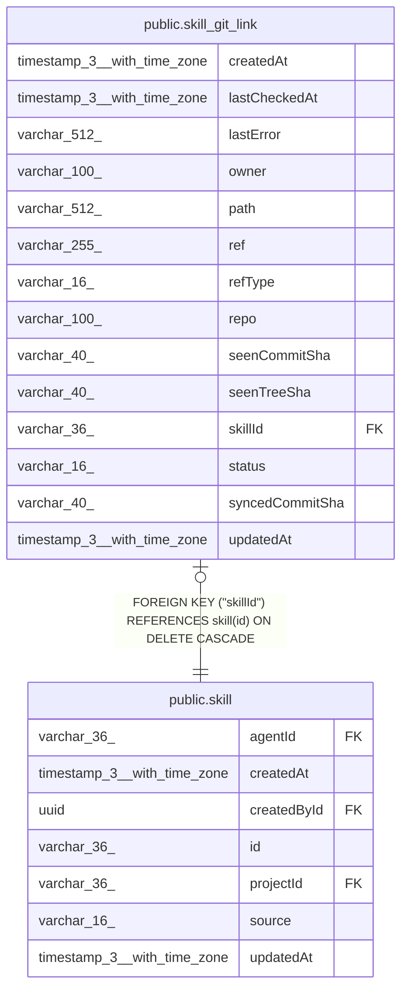

# public.skill_git_link

## Columns

| Name | Type | Default | Nullable | Children | Parents | Comment |
| ---- | ---- | ------- | -------- | -------- | ------- | ------- |
| createdAt | timestamp(3) with time zone | CURRENT_TIMESTAMP(3) | false |  |  |  |
| lastCheckedAt | timestamp(3) with time zone |  | true |  |  |  |
| lastError | varchar(512) |  | true |  |  |  |
| owner | varchar(100) |  | false |  |  |  |
| path | varchar(512) |  | false |  |  | The folder of SKILL.md in the repository |
| ref | varchar(255) |  | false |  |  | The branch, tag or commit SHA from the link the user pasted |
| refType | varchar(16) |  | false |  |  | "branch" gets updates. "tag" and "commit" are imported once |
| repo | varchar(100) |  | false |  |  |  |
| seenCommitSha | varchar(40) |  | false |  |  | The newest commit n8n handled: imported, accepted, skipped or waiting |
| seenTreeSha | varchar(40) |  | true |  |  | Git tree SHA of the folder at seenCommitSha. Unchanged = no update |
| skillId | varchar(36) |  | false |  | [public.skill](public.skill.md) |  |
| status | varchar(16) | 'ok'::character varying | false |  |  | "ok", "unavailable" or "rate_limited" |
| syncedCommitSha | varchar(40) |  | false |  |  | The commit of the latest version that came from GitHub |
| updatedAt | timestamp(3) with time zone | CURRENT_TIMESTAMP(3) | false |  |  |  |

## Constraints

| Name | Type | Definition |
| ---- | ---- | ---------- |
| FK_921a120cbf42aa023cd199bf16c | FOREIGN KEY | FOREIGN KEY ("skillId") REFERENCES skill(id) ON DELETE CASCADE |
| PK_921a120cbf42aa023cd199bf16c | PRIMARY KEY | PRIMARY KEY ("skillId") |
| skill_git_link_createdAt_not_null | n | NOT NULL "createdAt" |
| skill_git_link_owner_not_null | n | NOT NULL owner |
| skill_git_link_path_not_null | n | NOT NULL path |
| skill_git_link_refType_not_null | n | NOT NULL "refType" |
| skill_git_link_ref_not_null | n | NOT NULL ref |
| skill_git_link_repo_not_null | n | NOT NULL repo |
| skill_git_link_seenCommitSha_not_null | n | NOT NULL "seenCommitSha" |
| skill_git_link_skillId_not_null | n | NOT NULL "skillId" |
| skill_git_link_status_not_null | n | NOT NULL status |
| skill_git_link_syncedCommitSha_not_null | n | NOT NULL "syncedCommitSha" |
| skill_git_link_updatedAt_not_null | n | NOT NULL "updatedAt" |

## Indexes

| Name | Definition |
| ---- | ---------- |
| IDX_c516de102a027cf2c46d33d374 | CREATE INDEX "IDX_c516de102a027cf2c46d33d374" ON public.skill_git_link USING btree (owner, repo, ref) |
| PK_921a120cbf42aa023cd199bf16c | CREATE UNIQUE INDEX "PK_921a120cbf42aa023cd199bf16c" ON public.skill_git_link USING btree ("skillId") |

## Relations

---

> Generated by [tbls](https://github.com/k1LoW/tbls)
