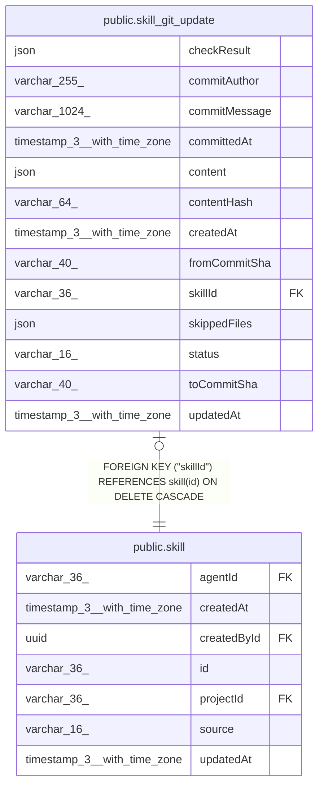

# public.skill_git_update

## Columns

| Name | Type | Default | Nullable | Children | Parents | Comment |
| ---- | ---- | ------- | -------- | -------- | ------- | ------- |
| checkResult | json |  | false |  |  | Security check result and findings for this exact content |
| commitAuthor | varchar(255) |  | true |  |  |  |
| commitMessage | varchar(1024) |  | true |  |  |  |
| committedAt | timestamp(3) with time zone |  | true |  |  |  |
| content | json |  | false |  |  | name, description, instructions, frontmatter, files |
| contentHash | varchar(64) |  | false |  |  |  |
| createdAt | timestamp(3) with time zone | CURRENT_TIMESTAMP(3) | false |  |  |  |
| fromCommitSha | varchar(40) |  | false |  |  |  |
| skillId | varchar(36) |  | false |  | [public.skill](public.skill.md) | One waiting update for each skill |
| skippedFiles | json |  | true |  |  | Files in the folder that n8n does not import |
| status | varchar(16) |  | false |  |  | "pending" or "blocked" |
| toCommitSha | varchar(40) |  | false |  |  |  |
| updatedAt | timestamp(3) with time zone | CURRENT_TIMESTAMP(3) | false |  |  |  |

## Constraints

| Name | Type | Definition |
| ---- | ---- | ---------- |
| FK_a8362e3b359bf4a6727e18e9f88 | FOREIGN KEY | FOREIGN KEY ("skillId") REFERENCES skill(id) ON DELETE CASCADE |
| PK_a8362e3b359bf4a6727e18e9f88 | PRIMARY KEY | PRIMARY KEY ("skillId") |
| skill_git_update_checkResult_not_null | n | NOT NULL "checkResult" |
| skill_git_update_contentHash_not_null | n | NOT NULL "contentHash" |
| skill_git_update_content_not_null | n | NOT NULL content |
| skill_git_update_createdAt_not_null | n | NOT NULL "createdAt" |
| skill_git_update_fromCommitSha_not_null | n | NOT NULL "fromCommitSha" |
| skill_git_update_skillId_not_null | n | NOT NULL "skillId" |
| skill_git_update_status_not_null | n | NOT NULL status |
| skill_git_update_toCommitSha_not_null | n | NOT NULL "toCommitSha" |
| skill_git_update_updatedAt_not_null | n | NOT NULL "updatedAt" |

## Indexes

| Name | Definition |
| ---- | ---------- |
| PK_a8362e3b359bf4a6727e18e9f88 | CREATE UNIQUE INDEX "PK_a8362e3b359bf4a6727e18e9f88" ON public.skill_git_update USING btree ("skillId") |

## Relations

---

> Generated by [tbls](https://github.com/k1LoW/tbls)
