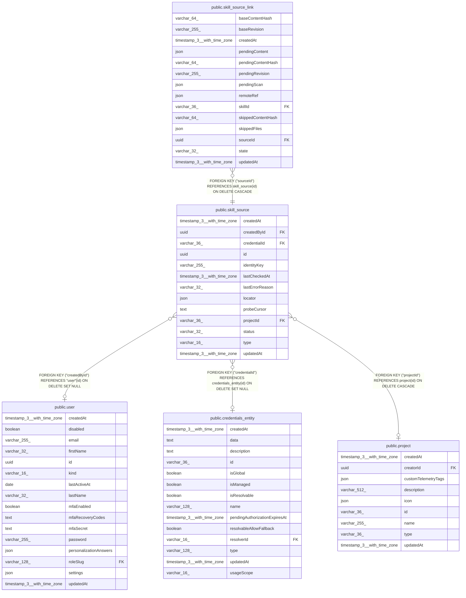

# public.skill_source

## Columns

| Name | Type | Default | Nullable | Children | Parents | Comment |
| ---- | ---- | ------- | -------- | -------- | ------- | ------- |
| createdAt | timestamp(3) with time zone | CURRENT_TIMESTAMP(3) | false |  |  |  |
| createdById | uuid |  | true |  | [public.user](public.user.md) | Creator. The check task reads the feature flag of this user. NULL after the user is deleted |
| credentialId | varchar(36) |  | true |  | [public.credentials_entity](public.credentials_entity.md) | Credential that reads a private source. NULL = public access |
| id | uuid |  | false | [public.skill_source_link](public.skill_source_link.md) |  | UUIDv7, made by the application |
| identityKey | varchar(255) |  | false |  |  | Source type, host, owner and repository in lower case, e.g. "github:github.com/acme/skills". The duplicate rules compare it |
| lastCheckedAt | timestamp(3) with time zone |  | true |  |  | End of the last check. NULL before the first check |
| lastErrorReason | varchar(32) |  | true |  |  | Reason code of the last failed check, e.g. "rate_limited". NULL after a success |
| locator | json |  | false |  |  | Where the skills are, as the client parsed it from the link. Opaque to the core |
| probeCursor | text |  | true |  |  | Opaque value of the last change probe, e.g. a commit SHA. NULL before the first check |
| projectId | varchar(36) |  | true |  | [public.project](public.project.md) | The scope: a team or personal project. NULL = Global |
| status | varchar(32) | 'connected'::character varying | false |  |  | Health of the source, set by the last check |
| type | varchar(16) |  | false |  |  | Source type, "github". Selects the client |
| updatedAt | timestamp(3) with time zone | CURRENT_TIMESTAMP(3) | false |  |  |  |

## Constraints

| Name | Type | Definition |
| ---- | ---- | ---------- |
| CHK_skill_source_status | CHECK | CHECK (((status)::text = ANY ((ARRAY['connected'::character varying, 'credential_expired'::character varying, 'unreachable'::character varying, 'delayed'::character varying])::text[]))) |
| FK_172d2de74bff36e50fef736a5e8 | FOREIGN KEY | FOREIGN KEY ("projectId") REFERENCES project(id) ON DELETE CASCADE |
| FK_1c91a0839e34c1b48610160761e | FOREIGN KEY | FOREIGN KEY ("createdById") REFERENCES "user"(id) ON DELETE SET NULL |
| FK_b3474e16029bf15a015e3f3a8d6 | FOREIGN KEY | FOREIGN KEY ("credentialId") REFERENCES credentials_entity(id) ON DELETE SET NULL |
| PK_c121774d21c9f67119b1d0d865a | PRIMARY KEY | PRIMARY KEY (id) |
| skill_source_createdAt_not_null | n | NOT NULL "createdAt" |
| skill_source_id_not_null | n | NOT NULL id |
| skill_source_identityKey_not_null | n | NOT NULL "identityKey" |
| skill_source_locator_not_null | n | NOT NULL locator |
| skill_source_status_not_null | n | NOT NULL status |
| skill_source_type_not_null | n | NOT NULL type |
| skill_source_updatedAt_not_null | n | NOT NULL "updatedAt" |

## Indexes

| Name | Definition |
| ---- | ---------- |
| IDX_172d2de74bff36e50fef736a5e | CREATE INDEX "IDX_172d2de74bff36e50fef736a5e" ON public.skill_source USING btree ("projectId") |
| IDX_skill_source_identityKey | CREATE UNIQUE INDEX "IDX_skill_source_identityKey" ON public.skill_source USING btree ("identityKey") WHERE ("projectId" IS NULL) |
| IDX_skill_source_identityKey_projectId | CREATE UNIQUE INDEX "IDX_skill_source_identityKey_projectId" ON public.skill_source USING btree ("identityKey", "projectId") WHERE ("projectId" IS NOT NULL) |
| PK_c121774d21c9f67119b1d0d865a | CREATE UNIQUE INDEX "PK_c121774d21c9f67119b1d0d865a" ON public.skill_source USING btree (id) |

## Relations

---

> Generated by [tbls](https://github.com/k1LoW/tbls)
