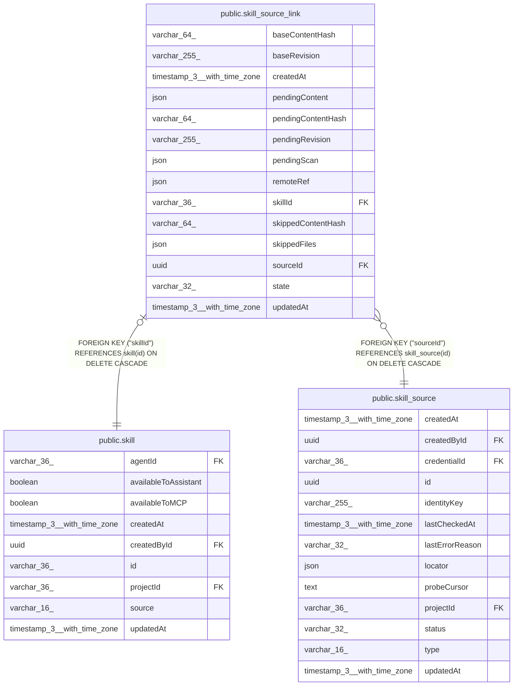

# public.skill_source_link

## Columns

| Name | Type | Default | Nullable | Children | Parents | Comment |
| ---- | ---- | ------- | -------- | -------- | ------- | ------- |
| baseContentHash | varchar(64) |  | false |  |  | skillContentHash of the latest accepted content |
| baseRevision | varchar(255) |  | false |  |  | Source revision of the content in the latest accepted version |
| createdAt | timestamp(3) with time zone | CURRENT_TIMESTAMP(3) | false |  |  |  |
| pendingContent | json |  | true |  |  | Skill content of the update that waits for review. NULL when no update waits |
| pendingContentHash | varchar(64) |  | true |  |  | skillContentHash of pendingContent. Accept refuses a review of other content |
| pendingRevision | varchar(255) |  | true |  |  | Source revision of pendingContent |
| pendingScan | json |  | true |  |  | Security check result of pendingContent: verdict and rule codes |
| remoteRef | json |  | false |  |  | Where the skill is in the source, e.g. its folder. Opaque to the core |
| skillId | varchar(36) |  | false |  | [public.skill](public.skill.md) | The synced skill. One link for each skill |
| skippedContentHash | varchar(64) |  | true |  |  | Content hash that the user skipped. A check hides an update with this hash |
| skippedFiles | json |  | false |  |  | Paths of the files that the import left out, e.g. scripts |
| sourceId | uuid |  | false |  | [public.skill_source](public.skill_source.md) | The source that syncs the skill |
| state | varchar(32) | 'up_to_date'::character varying | false |  |  | Sync state that badges and counts read |
| updatedAt | timestamp(3) with time zone | CURRENT_TIMESTAMP(3) | false |  |  |  |

## Constraints

| Name | Type | Definition |
| ---- | ---- | ---------- |
| CHK_skill_source_link_state | CHECK | CHECK (((state)::text = ANY ((ARRAY['up_to_date'::character varying, 'update_available'::character varying, 'update_blocked'::character varying, 'source_unavailable'::character varying])::text[]))) |
| FK_019d7a720d470af7c820fbb01ed | FOREIGN KEY | FOREIGN KEY ("skillId") REFERENCES skill(id) ON DELETE CASCADE |
| FK_8828a788906bc11d5a3dc6d87a0 | FOREIGN KEY | FOREIGN KEY ("sourceId") REFERENCES skill_source(id) ON DELETE CASCADE |
| PK_019d7a720d470af7c820fbb01ed | PRIMARY KEY | PRIMARY KEY ("skillId") |
| skill_source_link_baseContentHash_not_null | n | NOT NULL "baseContentHash" |
| skill_source_link_baseRevision_not_null | n | NOT NULL "baseRevision" |
| skill_source_link_createdAt_not_null | n | NOT NULL "createdAt" |
| skill_source_link_remoteRef_not_null | n | NOT NULL "remoteRef" |
| skill_source_link_skillId_not_null | n | NOT NULL "skillId" |
| skill_source_link_skippedFiles_not_null | n | NOT NULL "skippedFiles" |
| skill_source_link_sourceId_not_null | n | NOT NULL "sourceId" |
| skill_source_link_state_not_null | n | NOT NULL state |
| skill_source_link_updatedAt_not_null | n | NOT NULL "updatedAt" |

## Indexes

| Name | Definition |
| ---- | ---------- |
| IDX_8828a788906bc11d5a3dc6d87a | CREATE INDEX "IDX_8828a788906bc11d5a3dc6d87a" ON public.skill_source_link USING btree ("sourceId") |
| PK_019d7a720d470af7c820fbb01ed | CREATE UNIQUE INDEX "PK_019d7a720d470af7c820fbb01ed" ON public.skill_source_link USING btree ("skillId") |

## Relations

---

> Generated by [tbls](https://github.com/k1LoW/tbls)
