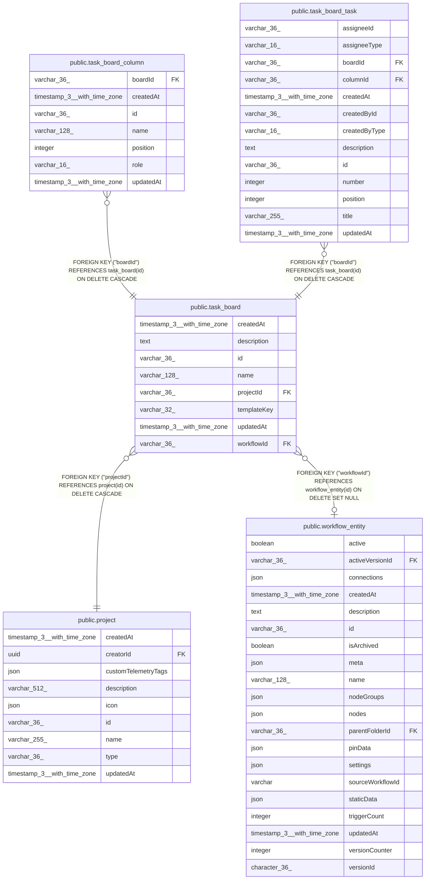

# public.task_board

## Columns

| Name | Type | Default | Nullable | Children | Parents | Comment |
| ---- | ---- | ------- | -------- | -------- | ------- | ------- |
| createdAt | timestamp(3) with time zone | CURRENT_TIMESTAMP(3) | false |  |  |  |
| description | text |  | true |  |  |  |
| id | varchar(36) |  | false | [public.task_board_column](public.task_board_column.md) [public.task_board_task](public.task_board_task.md) |  | nanoid, shown in URLs |
| name | varchar(128) |  | false |  |  |  |
| projectId | varchar(36) |  | false |  | [public.project](public.project.md) |  |
| templateKey | varchar(32) |  | true |  |  | Template that created the board, e.g. "agent-dev". NULL = no template |
| updatedAt | timestamp(3) with time zone | CURRENT_TIMESTAMP(3) | false |  |  |  |
| workflowId | varchar(36) |  | true |  | [public.workflow_entity](public.workflow_entity.md) | Dispatcher workflow that reacts to task events. NULL = none |

## Constraints

| Name | Type | Definition |
| ---- | ---- | ---------- |
| FK_a3a94f2f2ee4f3d10f7318ef75e | FOREIGN KEY | FOREIGN KEY ("workflowId") REFERENCES workflow_entity(id) ON DELETE SET NULL |
| FK_ba39c3ce02aa80f6f678f8baff0 | FOREIGN KEY | FOREIGN KEY ("projectId") REFERENCES project(id) ON DELETE CASCADE |
| PK_42a2758d8eff27aa9f58b642c21 | PRIMARY KEY | PRIMARY KEY (id) |
| task_board_createdAt_not_null | n | NOT NULL "createdAt" |
| task_board_id_not_null | n | NOT NULL id |
| task_board_name_not_null | n | NOT NULL name |
| task_board_projectId_not_null | n | NOT NULL "projectId" |
| task_board_updatedAt_not_null | n | NOT NULL "updatedAt" |

## Indexes

| Name | Definition |
| ---- | ---------- |
| IDX_ba39c3ce02aa80f6f678f8baff | CREATE INDEX "IDX_ba39c3ce02aa80f6f678f8baff" ON public.task_board USING btree ("projectId") |
| PK_42a2758d8eff27aa9f58b642c21 | CREATE UNIQUE INDEX "PK_42a2758d8eff27aa9f58b642c21" ON public.task_board USING btree (id) |

## Relations

---

> Generated by [tbls](https://github.com/k1LoW/tbls)
