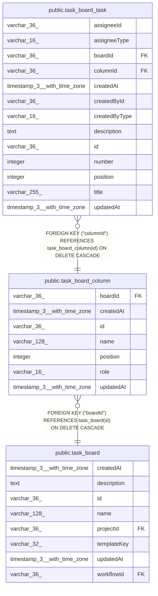

# public.task_board_column

## Columns

| Name | Type | Default | Nullable | Children | Parents | Comment |
| ---- | ---- | ------- | -------- | -------- | ------- | ------- |
| boardId | varchar(36) |  | false |  | [public.task_board](public.task_board.md) |  |
| createdAt | timestamp(3) with time zone | CURRENT_TIMESTAMP(3) | false |  |  |  |
| id | varchar(36) |  | false | [public.task_board_task](public.task_board_task.md) |  | nanoid |
| name | varchar(128) |  | false |  |  |  |
| position | integer |  | false |  |  | Display order, from left to right |
| role | varchar(16) |  | true |  |  | What the column means to workflows, independent of its name. NULL = no role |
| updatedAt | timestamp(3) with time zone | CURRENT_TIMESTAMP(3) | false |  |  |  |

## Constraints

| Name | Type | Definition |
| ---- | ---- | ---------- |
| CHK_task_board_column_role | CHECK | CHECK (((role)::text = ANY ((ARRAY['backlog'::character varying, 'todo'::character varying, 'in_progress'::character varying, 'needs_input'::character varying, 'done'::character varying])::text[]))) |
| FK_4339642715fd7781af01776fcaa | FOREIGN KEY | FOREIGN KEY ("boardId") REFERENCES task_board(id) ON DELETE CASCADE |
| PK_5e3961a67dddffd8ab78ab589e2 | PRIMARY KEY | PRIMARY KEY (id) |
| task_board_column_boardId_not_null | n | NOT NULL "boardId" |
| task_board_column_createdAt_not_null | n | NOT NULL "createdAt" |
| task_board_column_id_not_null | n | NOT NULL id |
| task_board_column_name_not_null | n | NOT NULL name |
| task_board_column_position_not_null | n | NOT NULL "position" |
| task_board_column_updatedAt_not_null | n | NOT NULL "updatedAt" |

## Indexes

| Name | Definition |
| ---- | ---------- |
| IDX_b34c4e6317b22b3af16af58144 | CREATE UNIQUE INDEX "IDX_b34c4e6317b22b3af16af58144" ON public.task_board_column USING btree ("boardId", role) |
| PK_5e3961a67dddffd8ab78ab589e2 | CREATE UNIQUE INDEX "PK_5e3961a67dddffd8ab78ab589e2" ON public.task_board_column USING btree (id) |

## Relations

---

> Generated by [tbls](https://github.com/k1LoW/tbls)
