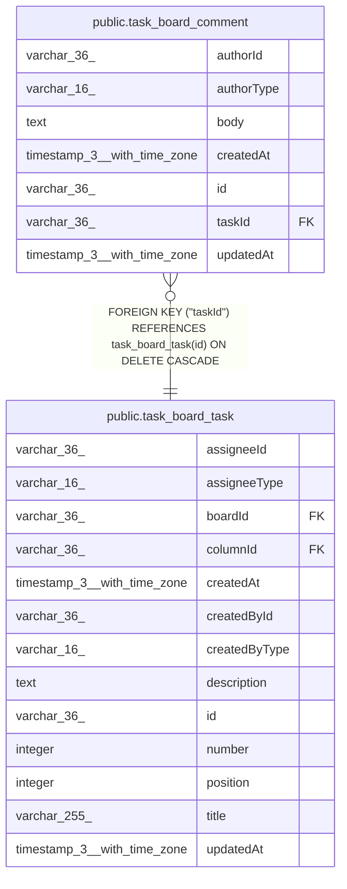

# public.task_board_comment

## Columns

| Name | Type | Default | Nullable | Children | Parents | Comment |
| ---- | ---- | ------- | -------- | -------- | ------- | ------- |
| authorId | varchar(36) |  | false |  |  | User id, agent id or workflow id, read with authorType |
| authorType | varchar(16) |  | false |  |  | Kind of actor that wrote the comment |
| body | text |  | false |  |  |  |
| createdAt | timestamp(3) with time zone | CURRENT_TIMESTAMP(3) | false |  |  |  |
| id | varchar(36) |  | false |  |  | nanoid |
| taskId | varchar(36) |  | false |  | [public.task_board_task](public.task_board_task.md) |  |
| updatedAt | timestamp(3) with time zone | CURRENT_TIMESTAMP(3) | false |  |  |  |

## Constraints

| Name | Type | Definition |
| ---- | ---- | ---------- |
| CHK_task_board_comment_authorType | CHECK | CHECK ((("authorType")::text = ANY ((ARRAY['user'::character varying, 'agent'::character varying, 'workflow'::character varying])::text[]))) |
| FK_49af02f0149d0eb23f18c07b7d4 | FOREIGN KEY | FOREIGN KEY ("taskId") REFERENCES task_board_task(id) ON DELETE CASCADE |
| PK_57b34189619185b4fc9b98419fd | PRIMARY KEY | PRIMARY KEY (id) |
| task_board_comment_authorId_not_null | n | NOT NULL "authorId" |
| task_board_comment_authorType_not_null | n | NOT NULL "authorType" |
| task_board_comment_body_not_null | n | NOT NULL body |
| task_board_comment_createdAt_not_null | n | NOT NULL "createdAt" |
| task_board_comment_id_not_null | n | NOT NULL id |
| task_board_comment_taskId_not_null | n | NOT NULL "taskId" |
| task_board_comment_updatedAt_not_null | n | NOT NULL "updatedAt" |

## Indexes

| Name | Definition |
| ---- | ---------- |
| IDX_49af02f0149d0eb23f18c07b7d | CREATE INDEX "IDX_49af02f0149d0eb23f18c07b7d" ON public.task_board_comment USING btree ("taskId") |
| PK_57b34189619185b4fc9b98419fd | CREATE UNIQUE INDEX "PK_57b34189619185b4fc9b98419fd" ON public.task_board_comment USING btree (id) |

## Relations

---

> Generated by [tbls](https://github.com/k1LoW/tbls)
