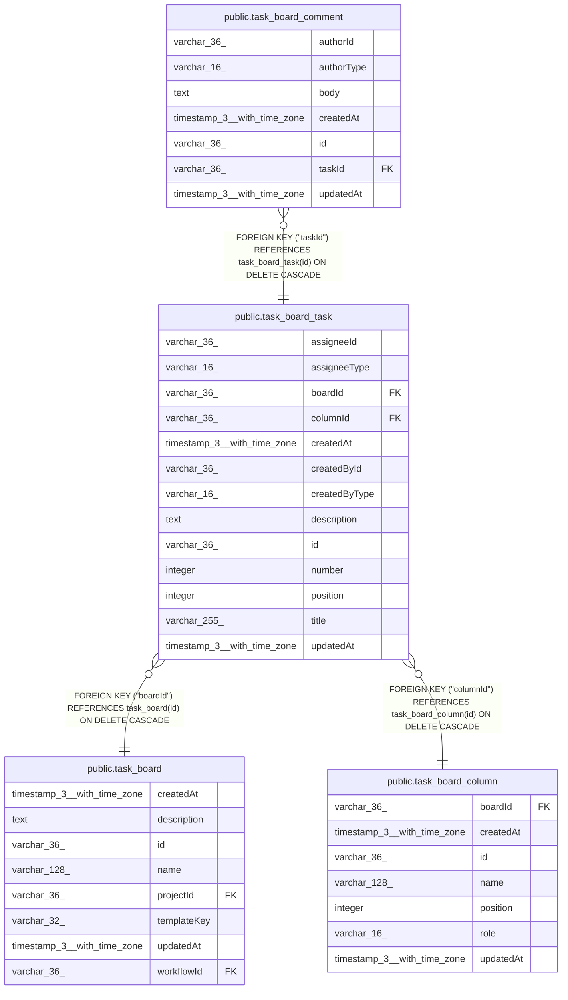

# public.task_board_task

## Columns

| Name | Type | Default | Nullable | Children | Parents | Comment |
| ---- | ---- | ------- | -------- | -------- | ------- | ------- |
| assigneeId | varchar(36) |  | true |  |  | User id or agent id, read with assigneeType. No foreign key |
| assigneeType | varchar(16) |  | true |  |  | Kind of assignee. NULL = unassigned |
| boardId | varchar(36) |  | false |  | [public.task_board](public.task_board.md) |  |
| columnId | varchar(36) |  | false |  | [public.task_board_column](public.task_board_column.md) |  |
| createdAt | timestamp(3) with time zone | CURRENT_TIMESTAMP(3) | false |  |  |  |
| createdById | varchar(36) |  | false |  |  | User id, agent id or workflow id, read with createdByType |
| createdByType | varchar(16) |  | false |  |  | Kind of actor that created the task |
| description | text | ''::text | false |  |  |  |
| id | varchar(36) |  | false | [public.task_board_comment](public.task_board_comment.md) |  | nanoid, shown in URLs |
| number | integer |  | false |  |  | Sequential number, unique within the board |
| position | integer |  | false |  |  | Display order within the column |
| title | varchar(255) |  | false |  |  |  |
| updatedAt | timestamp(3) with time zone | CURRENT_TIMESTAMP(3) | false |  |  |  |

## Constraints

| Name | Type | Definition |
| ---- | ---- | ---------- |
| CHK_task_board_task_assigneeType | CHECK | CHECK ((("assigneeType")::text = ANY ((ARRAY['user'::character varying, 'agent'::character varying])::text[]))) |
| CHK_task_board_task_createdByType | CHECK | CHECK ((("createdByType")::text = ANY ((ARRAY['user'::character varying, 'agent'::character varying, 'workflow'::character varying])::text[]))) |
| FK_36d6cbd2aa4767b580dab4125e5 | FOREIGN KEY | FOREIGN KEY ("columnId") REFERENCES task_board_column(id) ON DELETE CASCADE |
| FK_89cb150ce8f73eb95950c1f62b8 | FOREIGN KEY | FOREIGN KEY ("boardId") REFERENCES task_board(id) ON DELETE CASCADE |
| PK_a2182b2e1d1ac66c8097e0974b7 | PRIMARY KEY | PRIMARY KEY (id) |
| task_board_task_boardId_not_null | n | NOT NULL "boardId" |
| task_board_task_columnId_not_null | n | NOT NULL "columnId" |
| task_board_task_createdAt_not_null | n | NOT NULL "createdAt" |
| task_board_task_createdById_not_null | n | NOT NULL "createdById" |
| task_board_task_createdByType_not_null | n | NOT NULL "createdByType" |
| task_board_task_description_not_null | n | NOT NULL description |
| task_board_task_id_not_null | n | NOT NULL id |
| task_board_task_number_not_null | n | NOT NULL number |
| task_board_task_position_not_null | n | NOT NULL "position" |
| task_board_task_title_not_null | n | NOT NULL title |
| task_board_task_updatedAt_not_null | n | NOT NULL "updatedAt" |

## Indexes

| Name | Definition |
| ---- | ---------- |
| IDX_2bd3311b8ca9896d7e4addab0d | CREATE UNIQUE INDEX "IDX_2bd3311b8ca9896d7e4addab0d" ON public.task_board_task USING btree ("boardId", number) |
| IDX_36d6cbd2aa4767b580dab4125e | CREATE INDEX "IDX_36d6cbd2aa4767b580dab4125e" ON public.task_board_task USING btree ("columnId") |
| IDX_86521abe67595bc9bad8396edc | CREATE INDEX "IDX_86521abe67595bc9bad8396edc" ON public.task_board_task USING btree ("boardId", "columnId") |
| PK_a2182b2e1d1ac66c8097e0974b7 | CREATE UNIQUE INDEX "PK_a2182b2e1d1ac66c8097e0974b7" ON public.task_board_task USING btree (id) |

## Relations

---

> Generated by [tbls](https://github.com/k1LoW/tbls)
