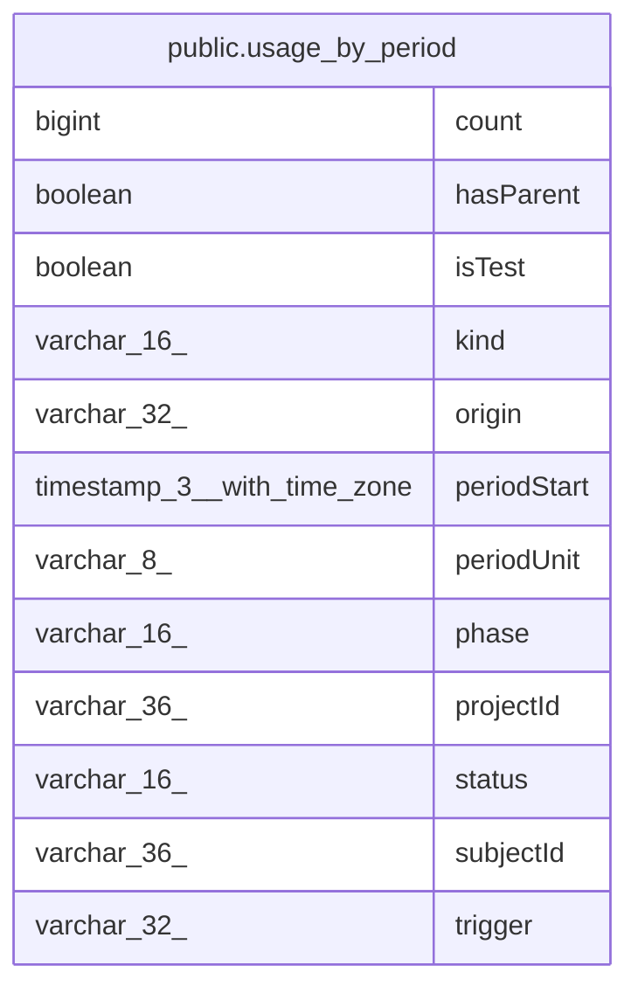

# public.usage_by_period

## Columns

| Name | Type | Default | Nullable | Children | Parents | Comment |
| ---- | ---- | ------- | -------- | -------- | ------- | ------- |
| count | bigint |  | false |  |  |  |
| hasParent | boolean |  | false |  |  |  |
| isTest | boolean |  | false |  |  |  |
| kind | varchar(16) |  | false |  |  |  |
| origin | varchar(32) |  | false |  |  |  |
| periodStart | timestamp(3) with time zone |  | false |  |  |  |
| periodUnit | varchar(8) |  | false |  |  |  |
| phase | varchar(16) |  | false |  |  |  |
| projectId | varchar(36) |  | false |  |  |  |
| status | varchar(16) |  | false |  |  |  |
| subjectId | varchar(36) |  | false |  |  |  |
| trigger | varchar(32) |  | false |  |  |  |

## Constraints

| Name | Type | Definition |
| ---- | ---- | ---------- |
| usage_by_period_count_not_null | n | NOT NULL count |
| usage_by_period_hasParent_not_null | n | NOT NULL "hasParent" |
| usage_by_period_isTest_not_null | n | NOT NULL "isTest" |
| usage_by_period_kind_not_null | n | NOT NULL kind |
| usage_by_period_origin_not_null | n | NOT NULL origin |
| usage_by_period_periodStart_not_null | n | NOT NULL "periodStart" |
| usage_by_period_periodUnit_not_null | n | NOT NULL "periodUnit" |
| usage_by_period_phase_not_null | n | NOT NULL phase |
| usage_by_period_pkey | PRIMARY KEY | PRIMARY KEY ("projectId", kind, "subjectId", phase, trigger, status, origin, "isTest", "hasParent", "periodUnit", "periodStart") |
| usage_by_period_projectId_not_null | n | NOT NULL "projectId" |
| usage_by_period_status_not_null | n | NOT NULL status |
| usage_by_period_subjectId_not_null | n | NOT NULL "subjectId" |
| usage_by_period_trigger_not_null | n | NOT NULL trigger |

## Indexes

| Name | Definition |
| ---- | ---------- |
| IDX_usage_by_period_project_kind | CREATE INDEX "IDX_usage_by_period_project_kind" ON public.usage_by_period USING btree ("projectId", kind, phase, "periodStart") |
| usage_by_period_pkey | CREATE UNIQUE INDEX usage_by_period_pkey ON public.usage_by_period USING btree ("projectId", kind, "subjectId", phase, trigger, status, origin, "isTest", "hasParent", "periodUnit", "periodStart") |

## Relations

---

> Generated by [tbls](https://github.com/k1LoW/tbls)
