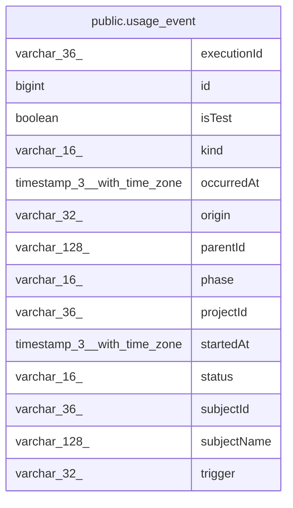

# public.usage_event

## Columns

| Name | Type | Default | Nullable | Children | Parents | Comment |
| ---- | ---- | ------- | -------- | -------- | ------- | ------- |
| executionId | varchar(36) |  | false |  |  |  |
| id | bigint |  | false |  |  |  |
| isTest | boolean |  | false |  |  |  |
| kind | varchar(16) |  | false |  |  |  |
| occurredAt | timestamp(3) with time zone |  | false |  |  |  |
| origin | varchar(32) |  | true |  |  |  |
| parentId | varchar(128) |  | true |  |  |  |
| phase | varchar(16) |  | false |  |  |  |
| projectId | varchar(36) |  | true |  |  |  |
| startedAt | timestamp(3) with time zone |  | true |  |  |  |
| status | varchar(16) |  | false |  |  |  |
| subjectId | varchar(36) |  | false |  |  |  |
| subjectName | varchar(128) |  | true |  |  |  |
| trigger | varchar(32) |  | false |  |  |  |

## Constraints

| Name | Type | Definition |
| ---- | ---- | ---------- |
| usage_event_executionId_not_null | n | NOT NULL "executionId" |
| usage_event_id_not_null | n | NOT NULL id |
| usage_event_isTest_not_null | n | NOT NULL "isTest" |
| usage_event_kind_not_null | n | NOT NULL kind |
| usage_event_occurredAt_not_null | n | NOT NULL "occurredAt" |
| usage_event_phase_not_null | n | NOT NULL phase |
| usage_event_pkey | PRIMARY KEY | PRIMARY KEY (id) |
| usage_event_status_not_null | n | NOT NULL status |
| usage_event_subjectId_not_null | n | NOT NULL "subjectId" |
| usage_event_trigger_not_null | n | NOT NULL trigger |

## Indexes

| Name | Definition |
| ---- | ---------- |
| usage_event_pkey | CREATE UNIQUE INDEX usage_event_pkey ON public.usage_event USING btree (id) |

## Relations

---

> Generated by [tbls](https://github.com/k1LoW/tbls)
