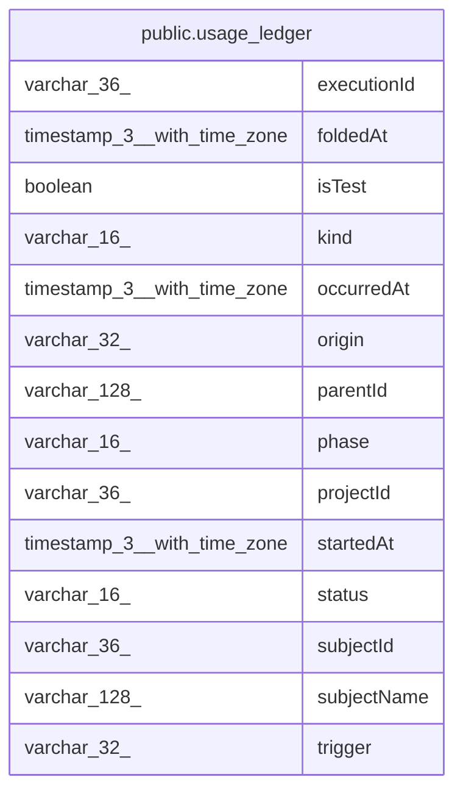

# public.usage_ledger

## Columns

| Name | Type | Default | Nullable | Children | Parents | Comment |
| ---- | ---- | ------- | -------- | -------- | ------- | ------- |
| executionId | varchar(36) |  | false |  |  |  |
| foldedAt | timestamp(3) with time zone | CURRENT_TIMESTAMP | false |  |  |  |
| isTest | boolean |  | false |  |  |  |
| kind | varchar(16) |  | false |  |  |  |
| occurredAt | timestamp(3) with time zone |  | false |  |  |  |
| origin | varchar(32) |  | true |  |  |  |
| parentId | varchar(128) |  | true |  |  |  |
| phase | varchar(16) |  | false |  |  |  |
| projectId | varchar(36) |  | true |  |  |  |
| startedAt | timestamp(3) with time zone |  | true |  |  |  |
| status | varchar(16) |  | false |  |  |  |
| subjectId | varchar(36) |  | false |  |  |  |
| subjectName | varchar(128) |  | true |  |  |  |
| trigger | varchar(32) |  | false |  |  |  |

## Constraints

| Name | Type | Definition |
| ---- | ---- | ---------- |
| usage_ledger_executionId_not_null | n | NOT NULL "executionId" |
| usage_ledger_foldedAt_not_null | n | NOT NULL "foldedAt" |
| usage_ledger_isTest_not_null | n | NOT NULL "isTest" |
| usage_ledger_kind_not_null | n | NOT NULL kind |
| usage_ledger_occurredAt_not_null | n | NOT NULL "occurredAt" |
| usage_ledger_phase_not_null | n | NOT NULL phase |
| usage_ledger_pkey | PRIMARY KEY | PRIMARY KEY (kind, "executionId", phase) |
| usage_ledger_status_not_null | n | NOT NULL status |
| usage_ledger_subjectId_not_null | n | NOT NULL "subjectId" |
| usage_ledger_trigger_not_null | n | NOT NULL trigger |

## Indexes

| Name | Definition |
| ---- | ---------- |
| IDX_usage_ledger_occurred_at | CREATE INDEX "IDX_usage_ledger_occurred_at" ON public.usage_ledger USING btree ("occurredAt") |
| usage_ledger_pkey | CREATE UNIQUE INDEX usage_ledger_pkey ON public.usage_ledger USING btree (kind, "executionId", phase) |

## Relations

---

> Generated by [tbls](https://github.com/k1LoW/tbls)
