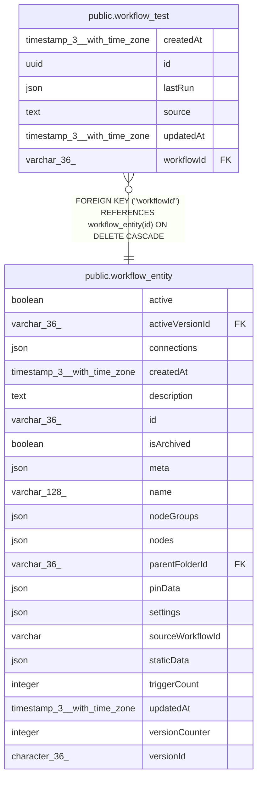

# public.workflow_test

## Columns

| Name | Type | Default | Nullable | Children | Parents | Comment |
| ---- | ---- | ------- | -------- | -------- | ------- | ------- |
| createdAt | timestamp(3) with time zone | CURRENT_TIMESTAMP(3) | false |  |  |  |
| id | uuid |  | false |  |  |  |
| lastRun | json |  | true |  |  | Result of the latest run of the stored source: run status, errors, and one entry for each test. NULL before the first run. |
| source | text |  | false |  |  | TypeScript source of the test file. |
| updatedAt | timestamp(3) with time zone | CURRENT_TIMESTAMP(3) | false |  |  |  |
| workflowId | varchar(36) |  | false |  | [public.workflow_entity](public.workflow_entity.md) |  |

## Constraints

| Name | Type | Definition |
| ---- | ---- | ---------- |
| FK_workflow_test_workflowId | FOREIGN KEY | FOREIGN KEY ("workflowId") REFERENCES workflow_entity(id) ON DELETE CASCADE |
| PK_611ed715178e9f487ef2502b655 | PRIMARY KEY | PRIMARY KEY (id) |
| workflow_test_createdAt_not_null | n | NOT NULL "createdAt" |
| workflow_test_id_not_null | n | NOT NULL id |
| workflow_test_source_not_null | n | NOT NULL source |
| workflow_test_updatedAt_not_null | n | NOT NULL "updatedAt" |
| workflow_test_workflowId_not_null | n | NOT NULL "workflowId" |

## Indexes

| Name | Definition |
| ---- | ---------- |
| IDX_d853ff88b7d1484b386d613043 | CREATE INDEX "IDX_d853ff88b7d1484b386d613043" ON public.workflow_test USING btree ("workflowId") |
| PK_611ed715178e9f487ef2502b655 | CREATE UNIQUE INDEX "PK_611ed715178e9f487ef2502b655" ON public.workflow_test USING btree (id) |

## Relations

---

> Generated by [tbls](https://github.com/k1LoW/tbls)
