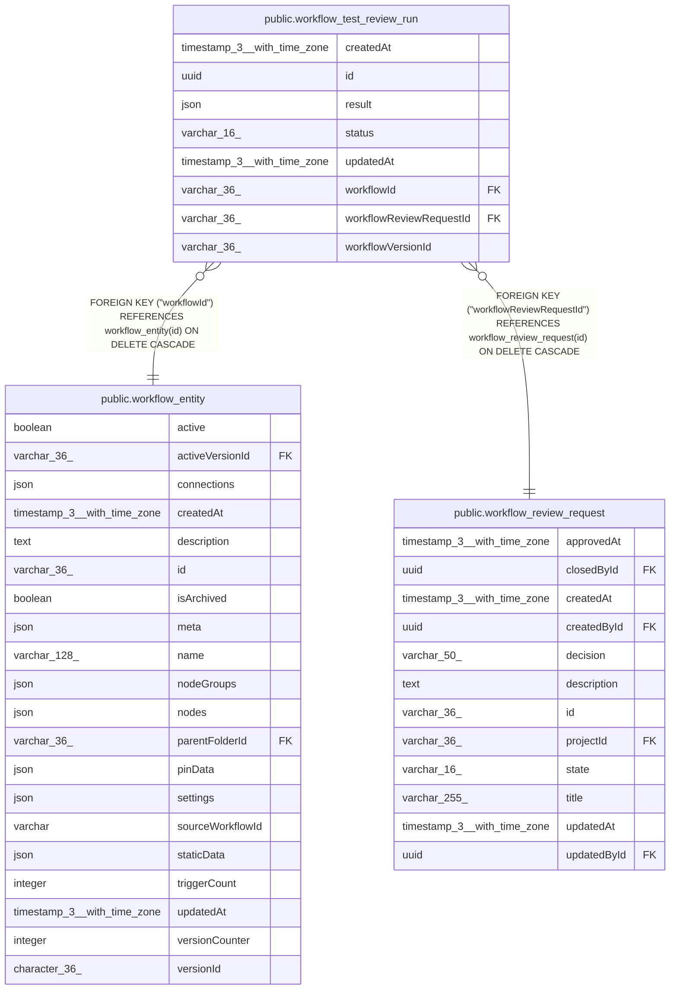

# public.workflow_test_review_run

## Columns

| Name | Type | Default | Nullable | Children | Parents | Comment |
| ---- | ---- | ------- | -------- | -------- | ------- | ------- |
| createdAt | timestamp(3) with time zone | CURRENT_TIMESTAMP(3) | false |  |  |  |
| id | uuid |  | false |  |  |  |
| result | json |  | true |  |  | Result of the run: run status, errors, and one entry for each test. NULL while the run is in progress. |
| status | varchar(16) |  | false |  |  | One of running, passed, failed, or error. |
| updatedAt | timestamp(3) with time zone | CURRENT_TIMESTAMP(3) | false |  |  |  |
| workflowId | varchar(36) |  | false |  | [public.workflow_entity](public.workflow_entity.md) |  |
| workflowReviewRequestId | varchar(36) |  | false |  | [public.workflow_review_request](public.workflow_review_request.md) |  |
| workflowVersionId | varchar(36) |  | false |  |  | The workflow history version that the tests ran on. |

## Constraints

| Name | Type | Definition |
| ---- | ---- | ---------- |
| FK_workflow_test_review_run_workflowId | FOREIGN KEY | FOREIGN KEY ("workflowId") REFERENCES workflow_entity(id) ON DELETE CASCADE |
| FK_workflow_test_review_run_workflowReviewRequestId | FOREIGN KEY | FOREIGN KEY ("workflowReviewRequestId") REFERENCES workflow_review_request(id) ON DELETE CASCADE |
| PK_34ef11a450dce3f9818bd9b8ca4 | PRIMARY KEY | PRIMARY KEY (id) |
| workflow_test_review_run_createdAt_not_null | n | NOT NULL "createdAt" |
| workflow_test_review_run_id_not_null | n | NOT NULL id |
| workflow_test_review_run_status_not_null | n | NOT NULL status |
| workflow_test_review_run_updatedAt_not_null | n | NOT NULL "updatedAt" |
| workflow_test_review_run_workflowId_not_null | n | NOT NULL "workflowId" |
| workflow_test_review_run_workflowReviewRequestId_not_null | n | NOT NULL "workflowReviewRequestId" |
| workflow_test_review_run_workflowVersionId_not_null | n | NOT NULL "workflowVersionId" |

## Indexes

| Name | Definition |
| ---- | ---------- |
| IDX_b29d300dcc5bdedfcc0d4dad37 | CREATE INDEX "IDX_b29d300dcc5bdedfcc0d4dad37" ON public.workflow_test_review_run USING btree ("workflowReviewRequestId", "workflowId") |
| PK_34ef11a450dce3f9818bd9b8ca4 | CREATE UNIQUE INDEX "PK_34ef11a450dce3f9818bd9b8ca4" ON public.workflow_test_review_run USING btree (id) |

## Relations

---

> Generated by [tbls](https://github.com/k1LoW/tbls)
