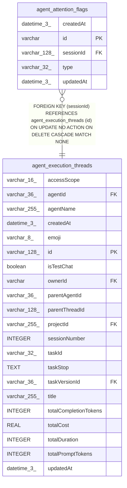

# agent_attention_flags

## Description

<details>
<summary><strong>Table Definition</strong></summary>

```sql
CREATE TABLE "agent_attention_flags" ("id" varchar PRIMARY KEY NOT NULL, "type" varchar(32) NOT NULL, "sessionId" varchar(128) NOT NULL, "createdAt" datetime(3) NOT NULL DEFAULT (STRFTIME('%Y-%m-%d %H:%M:%f', 'NOW')), "updatedAt" datetime(3) NOT NULL DEFAULT (STRFTIME('%Y-%m-%d %H:%M:%f', 'NOW')), CONSTRAINT "CHK_agent_attention_flags_type" CHECK ("type" IN ('session-error')), CONSTRAINT "FK_c4a1e0092b90219a7c4b951d7eb" FOREIGN KEY ("sessionId") REFERENCES "agent_execution_threads" ("id") ON DELETE CASCADE)
```

</details>

## Columns

| Name | Type | Default | Nullable | Children | Parents | Comment |
| ---- | ---- | ------- | -------- | -------- | ------- | ------- |
| createdAt | datetime(3) | STRFTIME('%Y-%m-%d %H:%M:%f', 'NOW') | false |  |  |  |
| id | varchar |  | false |  |  |  |
| sessionId | varchar(128) |  | false |  | [agent_execution_threads](agent_execution_threads.md) |  |
| type | varchar(32) |  | false |  |  |  |
| updatedAt | datetime(3) | STRFTIME('%Y-%m-%d %H:%M:%f', 'NOW') | false |  |  |  |

## Constraints

| Name | Type | Definition |
| ---- | ---- | ---------- |
| - | CHECK | CHECK ("type" IN ('session-error')) |
| - (Foreign key ID: 0) | FOREIGN KEY | FOREIGN KEY (sessionId) REFERENCES agent_execution_threads (id) ON UPDATE NO ACTION ON DELETE CASCADE MATCH NONE |
| id | PRIMARY KEY | PRIMARY KEY (id) |
| sqlite_autoindex_agent_attention_flags_1 | PRIMARY KEY | PRIMARY KEY (id) |

## Indexes

| Name | Definition |
| ---- | ---------- |
| IDX_b9b809f51859fe693ada9a29dd | CREATE UNIQUE INDEX "IDX_b9b809f51859fe693ada9a29dd" ON "agent_attention_flags" ("sessionId", "type")  |
| sqlite_autoindex_agent_attention_flags_1 | PRIMARY KEY (id) |

## Relations



---

> Generated by [tbls](https://github.com/k1LoW/tbls)
