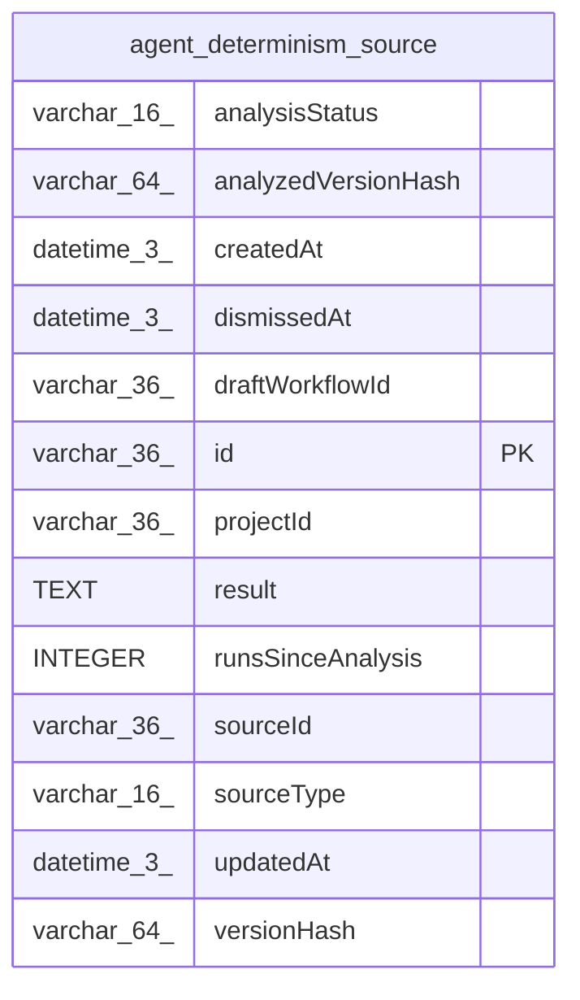

# agent_determinism_source

## Description

<details>
<summary><strong>Table Definition</strong></summary>

```sql
CREATE TABLE "agent_determinism_source" ("id" varchar(36) PRIMARY KEY NOT NULL, "sourceType" varchar(16) NOT NULL, "sourceId" varchar(36) NOT NULL, "projectId" varchar(36) NOT NULL, "versionHash" varchar(64) NOT NULL, "runsSinceAnalysis" integer NOT NULL DEFAULT (0), "analysisStatus" varchar(16) NOT NULL, "analyzedVersionHash" varchar(64), "draftWorkflowId" varchar(36), "result" text, "dismissedAt" datetime(3), "createdAt" datetime(3) NOT NULL DEFAULT (STRFTIME('%Y-%m-%d %H:%M:%f', 'NOW')), "updatedAt" datetime(3) NOT NULL DEFAULT (STRFTIME('%Y-%m-%d %H:%M:%f', 'NOW')))
```

</details>

## Columns

| Name | Type | Default | Nullable | Children | Parents | Comment |
| ---- | ---- | ------- | -------- | -------- | ------- | ------- |
| analysisStatus | varchar(16) |  | false |  |  |  |
| analyzedVersionHash | varchar(64) |  | true |  |  |  |
| createdAt | datetime(3) | STRFTIME('%Y-%m-%d %H:%M:%f', 'NOW') | false |  |  |  |
| dismissedAt | datetime(3) |  | true |  |  |  |
| draftWorkflowId | varchar(36) |  | true |  |  |  |
| id | varchar(36) |  | false |  |  |  |
| projectId | varchar(36) |  | false |  |  |  |
| result | TEXT |  | true |  |  |  |
| runsSinceAnalysis | INTEGER | 0 | false |  |  |  |
| sourceId | varchar(36) |  | false |  |  |  |
| sourceType | varchar(16) |  | false |  |  |  |
| updatedAt | datetime(3) | STRFTIME('%Y-%m-%d %H:%M:%f', 'NOW') | false |  |  |  |
| versionHash | varchar(64) |  | false |  |  |  |

## Constraints

| Name | Type | Definition |
| ---- | ---- | ---------- |
| id | PRIMARY KEY | PRIMARY KEY (id) |
| sqlite_autoindex_agent_determinism_source_1 | PRIMARY KEY | PRIMARY KEY (id) |

## Indexes

| Name | Definition |
| ---- | ---------- |
| IDX_4c9a157e747aa128183938bf1d | CREATE UNIQUE INDEX "IDX_4c9a157e747aa128183938bf1d" ON "agent_determinism_source" ("sourceType", "sourceId")  |
| sqlite_autoindex_agent_determinism_source_1 | PRIMARY KEY (id) |

## Relations



---

> Generated by [tbls](https://github.com/k1LoW/tbls)
