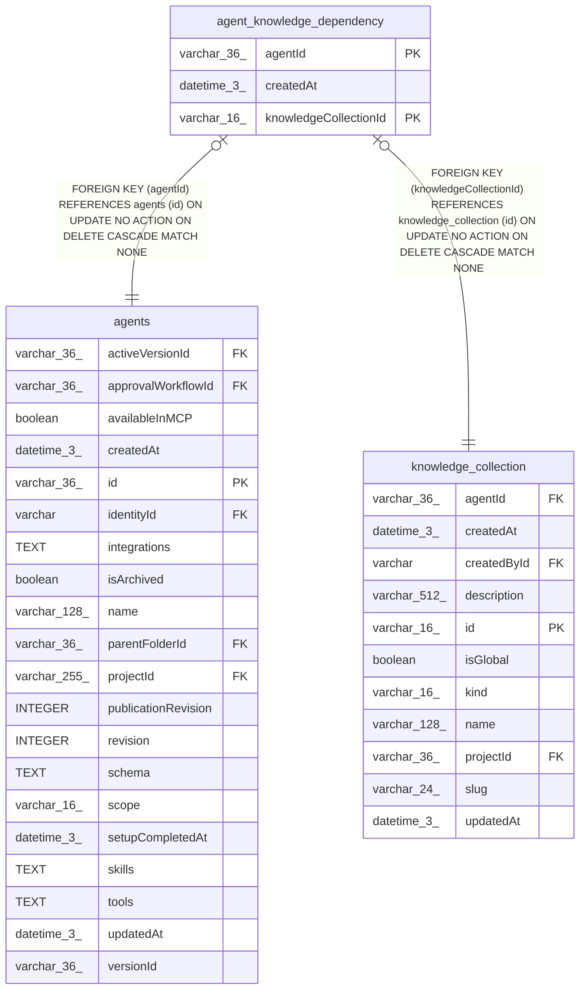

# agent_knowledge_dependency

## Description

<details>
<summary><strong>Table Definition</strong></summary>

```sql
CREATE TABLE "agent_knowledge_dependency" ("agentId" varchar(36) NOT NULL, "knowledgeCollectionId" varchar(16) NOT NULL, "createdAt" datetime(3) NOT NULL DEFAULT (STRFTIME('%Y-%m-%d %H:%M:%f', 'NOW')), CONSTRAINT "FK_26036d7e3f258bf7f5a8d3d84c1" FOREIGN KEY ("agentId") REFERENCES "agents" ("id") ON DELETE CASCADE, CONSTRAINT "FK_25c107679cd738e030bdd7f4a66" FOREIGN KEY ("knowledgeCollectionId") REFERENCES "knowledge_collection" ("id") ON DELETE CASCADE, PRIMARY KEY ("agentId", "knowledgeCollectionId"))
```

</details>

## Columns

| Name | Type | Default | Nullable | Children | Parents | Comment |
| ---- | ---- | ------- | -------- | -------- | ------- | ------- |
| agentId | varchar(36) |  | false |  | [agents](agents.md) |  |
| createdAt | datetime(3) | STRFTIME('%Y-%m-%d %H:%M:%f', 'NOW') | false |  |  |  |
| knowledgeCollectionId | varchar(16) |  | false |  | [knowledge_collection](knowledge_collection.md) |  |

## Constraints

| Name | Type | Definition |
| ---- | ---- | ---------- |
| - (Foreign key ID: 0) | FOREIGN KEY | FOREIGN KEY (knowledgeCollectionId) REFERENCES knowledge_collection (id) ON UPDATE NO ACTION ON DELETE CASCADE MATCH NONE |
| - (Foreign key ID: 1) | FOREIGN KEY | FOREIGN KEY (agentId) REFERENCES agents (id) ON UPDATE NO ACTION ON DELETE CASCADE MATCH NONE |
| agentId | PRIMARY KEY | PRIMARY KEY (agentId) |
| knowledgeCollectionId | PRIMARY KEY | PRIMARY KEY (knowledgeCollectionId) |
| sqlite_autoindex_agent_knowledge_dependency_1 | PRIMARY KEY | PRIMARY KEY (agentId, knowledgeCollectionId) |

## Indexes

| Name | Definition |
| ---- | ---------- |
| IDX_25c107679cd738e030bdd7f4a6 | CREATE INDEX "IDX_25c107679cd738e030bdd7f4a6" ON "agent_knowledge_dependency" ("knowledgeCollectionId")  |
| sqlite_autoindex_agent_knowledge_dependency_1 | PRIMARY KEY (agentId, knowledgeCollectionId) |

## Relations



---

> Generated by [tbls](https://github.com/k1LoW/tbls)
