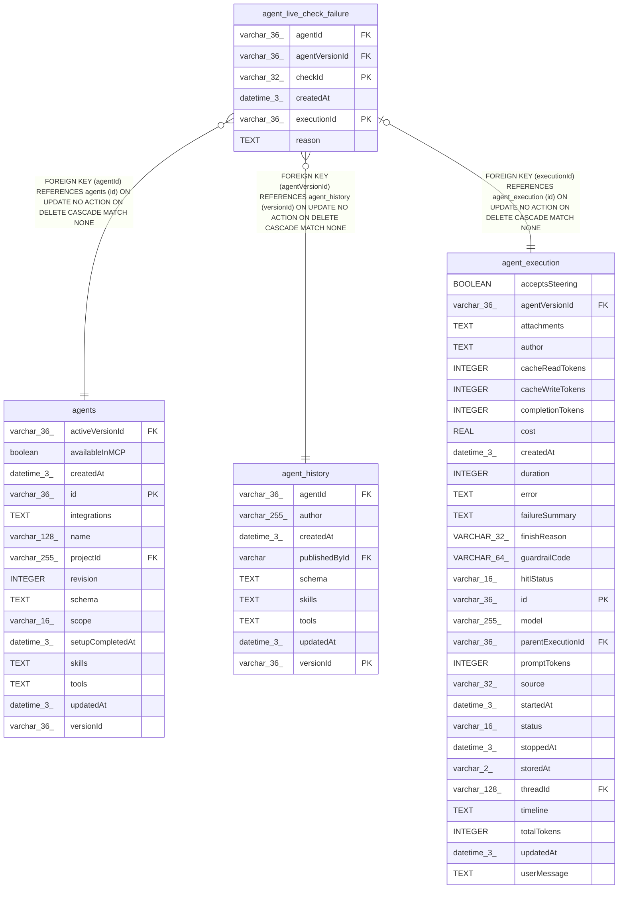

# agent_live_check_failure

## Description

<details>
<summary><strong>Table Definition</strong></summary>

```sql
CREATE TABLE "agent_live_check_failure" ("executionId" varchar(36) NOT NULL, "checkId" varchar(32) NOT NULL, "agentId" varchar(36) NOT NULL, "agentVersionId" varchar(36) NOT NULL, "reason" text NOT NULL, "createdAt" datetime(3) NOT NULL DEFAULT (STRFTIME('%Y-%m-%d %H:%M:%f', 'NOW')), CONSTRAINT "CHK_agent_live_check_failure_checkId" CHECK ("checkId" IN ('tool:empty_reply', 'tool:tool_failed', 'tool:repeated_call', 'tool:acted_after_no', 'tool:hit_limit')), CONSTRAINT "FK_aaeac29fbbc9a9f3f5bd4f4f570" FOREIGN KEY ("executionId") REFERENCES "agent_execution" ("id") ON DELETE CASCADE, CONSTRAINT "FK_e9f8050785b3263d8535bf6a848" FOREIGN KEY ("agentId") REFERENCES "agents" ("id") ON DELETE CASCADE, CONSTRAINT "FK_7c9052dbeaefdb7d222a37dc804" FOREIGN KEY ("agentVersionId") REFERENCES "agent_history" ("versionId") ON DELETE CASCADE, PRIMARY KEY ("executionId", "checkId"))
```

</details>

## Columns

| Name | Type | Default | Nullable | Children | Parents | Comment |
| ---- | ---- | ------- | -------- | -------- | ------- | ------- |
| agentId | varchar(36) |  | false |  | [agents](agents.md) |  |
| agentVersionId | varchar(36) |  | false |  | [agent_history](agent_history.md) |  |
| checkId | varchar(32) |  | false |  |  |  |
| createdAt | datetime(3) | STRFTIME('%Y-%m-%d %H:%M:%f', 'NOW') | false |  |  |  |
| executionId | varchar(36) |  | false |  | [agent_execution](agent_execution.md) |  |
| reason | TEXT |  | false |  |  |  |

## Constraints

| Name | Type | Definition |
| ---- | ---- | ---------- |
| - | CHECK | CHECK ("checkId" IN ('tool:empty_reply', 'tool:tool_failed', 'tool:repeated_call', 'tool:acted_after_no', 'tool:hit_limit')) |
| - (Foreign key ID: 0) | FOREIGN KEY | FOREIGN KEY (agentVersionId) REFERENCES agent_history (versionId) ON UPDATE NO ACTION ON DELETE CASCADE MATCH NONE |
| - (Foreign key ID: 1) | FOREIGN KEY | FOREIGN KEY (agentId) REFERENCES agents (id) ON UPDATE NO ACTION ON DELETE CASCADE MATCH NONE |
| - (Foreign key ID: 2) | FOREIGN KEY | FOREIGN KEY (executionId) REFERENCES agent_execution (id) ON UPDATE NO ACTION ON DELETE CASCADE MATCH NONE |
| checkId | PRIMARY KEY | PRIMARY KEY (checkId) |
| executionId | PRIMARY KEY | PRIMARY KEY (executionId) |
| sqlite_autoindex_agent_live_check_failure_1 | PRIMARY KEY | PRIMARY KEY (executionId, checkId) |

## Indexes

| Name | Definition |
| ---- | ---------- |
| IDX_e9f8050785b3263d8535bf6a84 | CREATE INDEX "IDX_e9f8050785b3263d8535bf6a84" ON "agent_live_check_failure" ("agentId")  |
| IDX_f9e92761f8a9b1b8b6c1667b87 | CREATE INDEX "IDX_f9e92761f8a9b1b8b6c1667b87" ON "agent_live_check_failure" ("agentVersionId", "checkId")  |
| sqlite_autoindex_agent_live_check_failure_1 | PRIMARY KEY (executionId, checkId) |

## Relations



---

> Generated by [tbls](https://github.com/k1LoW/tbls)
