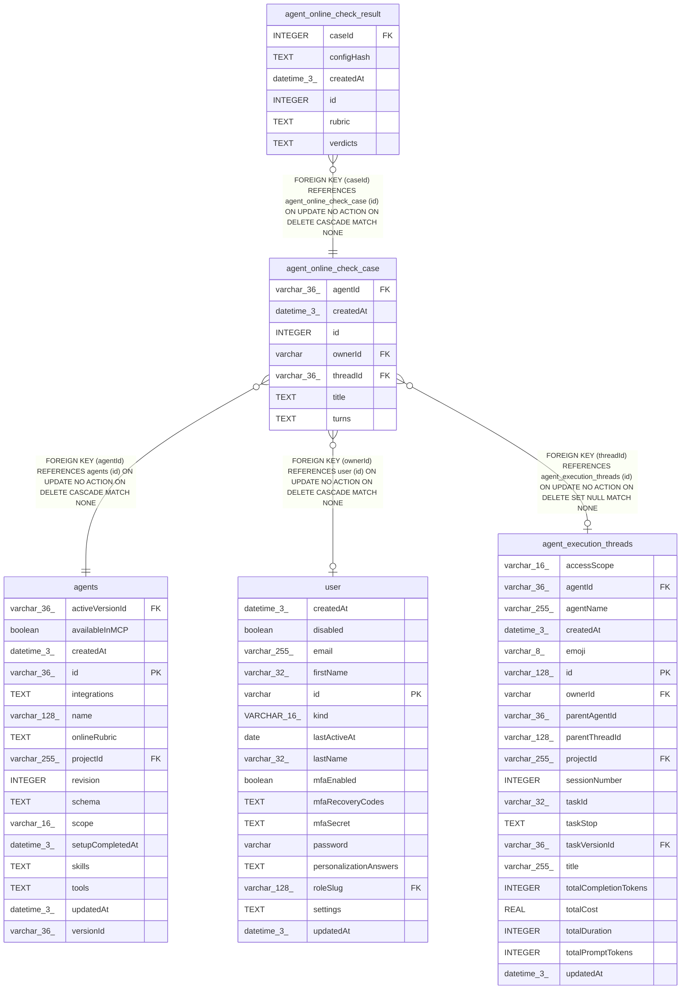

# agent_online_check_case

## Description

<details>
<summary><strong>Table Definition</strong></summary>

```sql
CREATE TABLE "agent_online_check_case" ("id" integer PRIMARY KEY NOT NULL, "agentId" varchar(36) NOT NULL, "threadId" varchar(36), "ownerId" varchar, "title" text NOT NULL, "turns" text NOT NULL, "createdAt" datetime(3) NOT NULL DEFAULT (STRFTIME('%Y-%m-%d %H:%M:%f', 'NOW')), CONSTRAINT "FK_7682eae615389d171b08c60448a" FOREIGN KEY ("agentId") REFERENCES "agents" ("id") ON DELETE CASCADE, CONSTRAINT "FK_0c29c5228e51f60abec88c55221" FOREIGN KEY ("threadId") REFERENCES "agent_execution_threads" ("id") ON DELETE SET NULL, CONSTRAINT "FK_f1f3f3140085687ec765326693c" FOREIGN KEY ("ownerId") REFERENCES "user" ("id") ON DELETE CASCADE)
```

</details>

## Columns

| Name | Type | Default | Nullable | Children | Parents | Comment |
| ---- | ---- | ------- | -------- | -------- | ------- | ------- |
| agentId | varchar(36) |  | false |  | [agents](agents.md) |  |
| createdAt | datetime(3) | STRFTIME('%Y-%m-%d %H:%M:%f', 'NOW') | false |  |  |  |
| id | INTEGER |  | false | [agent_online_check_result](agent_online_check_result.md) |  |  |
| ownerId | varchar |  | true |  | [user](user.md) |  |
| threadId | varchar(36) |  | true |  | [agent_execution_threads](agent_execution_threads.md) |  |
| title | TEXT |  | false |  |  |  |
| turns | TEXT |  | false |  |  |  |

## Constraints

| Name | Type | Definition |
| ---- | ---- | ---------- |
| - (Foreign key ID: 0) | FOREIGN KEY | FOREIGN KEY (ownerId) REFERENCES user (id) ON UPDATE NO ACTION ON DELETE CASCADE MATCH NONE |
| - (Foreign key ID: 1) | FOREIGN KEY | FOREIGN KEY (threadId) REFERENCES agent_execution_threads (id) ON UPDATE NO ACTION ON DELETE SET NULL MATCH NONE |
| - (Foreign key ID: 2) | FOREIGN KEY | FOREIGN KEY (agentId) REFERENCES agents (id) ON UPDATE NO ACTION ON DELETE CASCADE MATCH NONE |
| id | PRIMARY KEY | PRIMARY KEY (id) |

## Indexes

| Name | Definition |
| ---- | ---------- |
| IDX_0c29c5228e51f60abec88c5522 | CREATE INDEX "IDX_0c29c5228e51f60abec88c5522" ON "agent_online_check_case" ("threadId")  |
| IDX_c8070d4ec8131270dbf8e0ec02 | CREATE UNIQUE INDEX "IDX_c8070d4ec8131270dbf8e0ec02" ON "agent_online_check_case" ("agentId", "threadId")  |
| IDX_f1f3f3140085687ec765326693 | CREATE INDEX "IDX_f1f3f3140085687ec765326693" ON "agent_online_check_case" ("ownerId")  |

## Relations



---

> Generated by [tbls](https://github.com/k1LoW/tbls)
