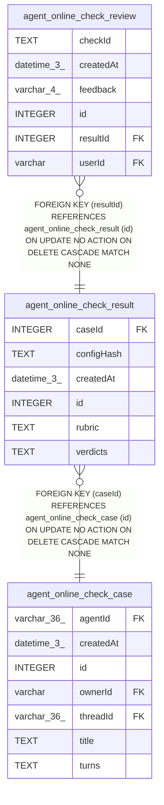

# agent_online_check_result

## Description

<details>
<summary><strong>Table Definition</strong></summary>

```sql
CREATE TABLE "agent_online_check_result" ("id" integer PRIMARY KEY NOT NULL, "caseId" integer NOT NULL, "rubric" text NOT NULL, "configHash" text NOT NULL, "verdicts" text NOT NULL, "createdAt" datetime(3) NOT NULL DEFAULT (STRFTIME('%Y-%m-%d %H:%M:%f', 'NOW')), CONSTRAINT "FK_93833ba94399609db442c1feafc" FOREIGN KEY ("caseId") REFERENCES "agent_online_check_case" ("id") ON DELETE CASCADE)
```

</details>

## Columns

| Name | Type | Default | Nullable | Children | Parents | Comment |
| ---- | ---- | ------- | -------- | -------- | ------- | ------- |
| caseId | INTEGER |  | false |  | [agent_online_check_case](agent_online_check_case.md) |  |
| configHash | TEXT |  | false |  |  |  |
| createdAt | datetime(3) | STRFTIME('%Y-%m-%d %H:%M:%f', 'NOW') | false |  |  |  |
| id | INTEGER |  | false | [agent_online_check_review](agent_online_check_review.md) |  |  |
| rubric | TEXT |  | false |  |  |  |
| verdicts | TEXT |  | false |  |  |  |

## Constraints

| Name | Type | Definition |
| ---- | ---- | ---------- |
| - (Foreign key ID: 0) | FOREIGN KEY | FOREIGN KEY (caseId) REFERENCES agent_online_check_case (id) ON UPDATE NO ACTION ON DELETE CASCADE MATCH NONE |
| id | PRIMARY KEY | PRIMARY KEY (id) |

## Indexes

| Name | Definition |
| ---- | ---------- |
| IDX_93833ba94399609db442c1feaf | CREATE INDEX "IDX_93833ba94399609db442c1feaf" ON "agent_online_check_result" ("caseId")  |

## Relations



---

> Generated by [tbls](https://github.com/k1LoW/tbls)
