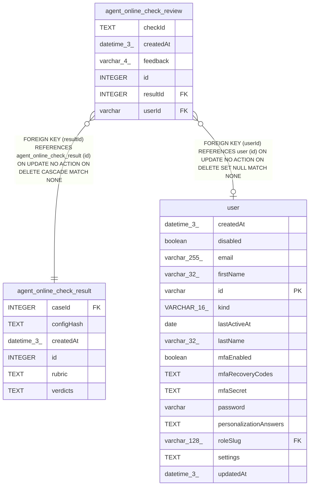

# agent_online_check_review

## Description

<details>
<summary><strong>Table Definition</strong></summary>

```sql
CREATE TABLE "agent_online_check_review" ("id" integer PRIMARY KEY NOT NULL, "resultId" integer NOT NULL, "userId" varchar, "checkId" text NOT NULL, "feedback" varchar(4) NOT NULL, "createdAt" datetime(3) NOT NULL DEFAULT (STRFTIME('%Y-%m-%d %H:%M:%f', 'NOW')), CONSTRAINT "CHK_agent_online_check_review_feedback" CHECK ("feedback" IN ('good', 'bad')), CONSTRAINT "FK_53dd5681e35e283f5a6fada90d5" FOREIGN KEY ("resultId") REFERENCES "agent_online_check_result" ("id") ON DELETE CASCADE, CONSTRAINT "FK_2b75b7a8b26454440367fa6e625" FOREIGN KEY ("userId") REFERENCES "user" ("id") ON DELETE SET NULL)
```

</details>

## Columns

| Name | Type | Default | Nullable | Children | Parents | Comment |
| ---- | ---- | ------- | -------- | -------- | ------- | ------- |
| checkId | TEXT |  | false |  |  |  |
| createdAt | datetime(3) | STRFTIME('%Y-%m-%d %H:%M:%f', 'NOW') | false |  |  |  |
| feedback | varchar(4) |  | false |  |  |  |
| id | INTEGER |  | false |  |  |  |
| resultId | INTEGER |  | false |  | [agent_online_check_result](agent_online_check_result.md) |  |
| userId | varchar |  | true |  | [user](user.md) |  |

## Constraints

| Name | Type | Definition |
| ---- | ---- | ---------- |
| - | CHECK | CHECK ("feedback" IN ('good', 'bad')) |
| - (Foreign key ID: 0) | FOREIGN KEY | FOREIGN KEY (userId) REFERENCES user (id) ON UPDATE NO ACTION ON DELETE SET NULL MATCH NONE |
| - (Foreign key ID: 1) | FOREIGN KEY | FOREIGN KEY (resultId) REFERENCES agent_online_check_result (id) ON UPDATE NO ACTION ON DELETE CASCADE MATCH NONE |
| id | PRIMARY KEY | PRIMARY KEY (id) |

## Indexes

| Name | Definition |
| ---- | ---------- |
| IDX_2b75b7a8b26454440367fa6e62 | CREATE INDEX "IDX_2b75b7a8b26454440367fa6e62" ON "agent_online_check_review" ("userId")  |
| IDX_53dd5681e35e283f5a6fada90d | CREATE INDEX "IDX_53dd5681e35e283f5a6fada90d" ON "agent_online_check_review" ("resultId")  |

## Relations



---

> Generated by [tbls](https://github.com/k1LoW/tbls)
