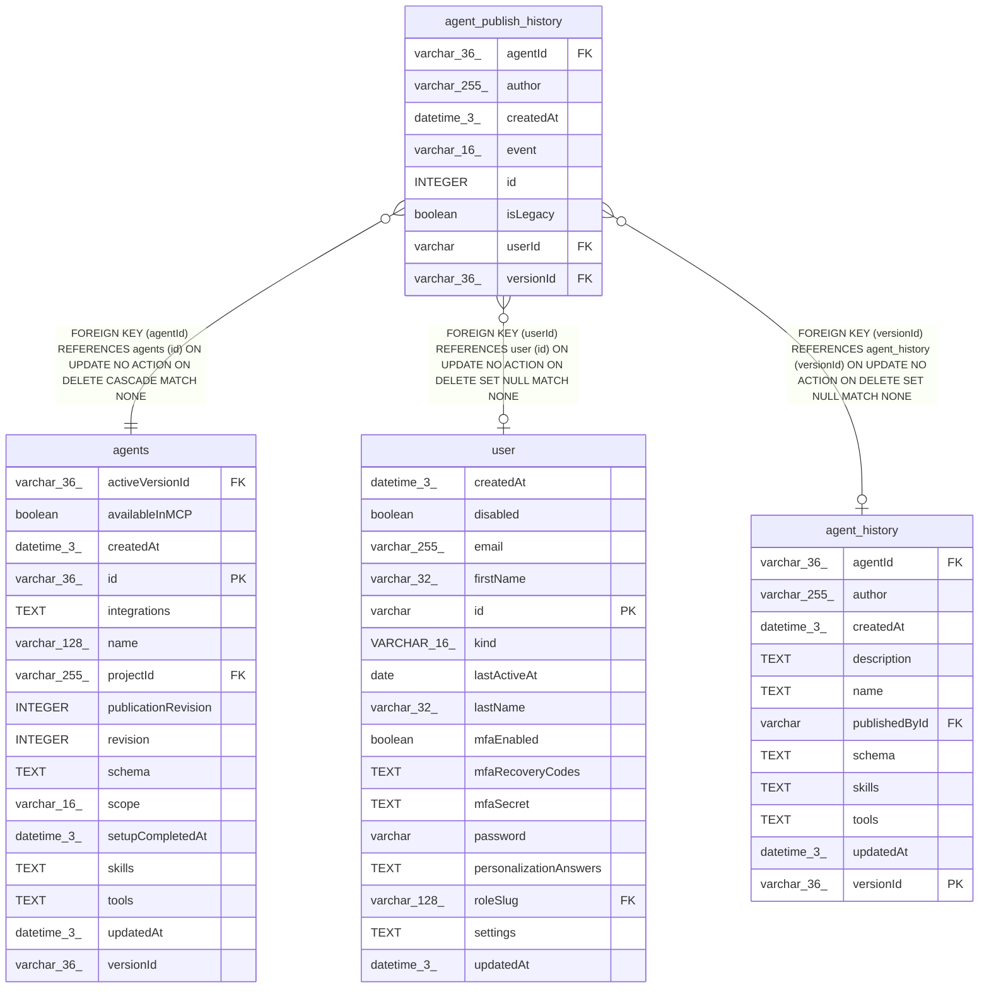

# agent_publish_history

## Description

<details>
<summary><strong>Table Definition</strong></summary>

```sql
CREATE TABLE "agent_publish_history" ("id" integer PRIMARY KEY NOT NULL, "agentId" varchar(36) NOT NULL, "versionId" varchar(36), "event" varchar(16) NOT NULL, "userId" varchar, "author" varchar(255) NOT NULL, "isLegacy" boolean NOT NULL DEFAULT (false), "createdAt" datetime(3) NOT NULL DEFAULT (STRFTIME('%Y-%m-%d %H:%M:%f', 'NOW')), CONSTRAINT "CHK_agent_publish_history_event" CHECK ("event" IN ('activated', 'deactivated')), CONSTRAINT "FK_338ce0ca892475cbf83e950323c" FOREIGN KEY ("agentId") REFERENCES "agents" ("id") ON DELETE CASCADE, CONSTRAINT "FK_c76452ef7aca39928df3ca8dccd" FOREIGN KEY ("versionId") REFERENCES "agent_history" ("versionId") ON DELETE SET NULL, CONSTRAINT "FK_6b706839e7bff5e94cf73d9c691" FOREIGN KEY ("userId") REFERENCES "user" ("id") ON DELETE SET NULL)
```

</details>

## Columns

| Name | Type | Default | Nullable | Children | Parents | Comment |
| ---- | ---- | ------- | -------- | -------- | ------- | ------- |
| agentId | varchar(36) |  | false |  | [agents](agents.md) |  |
| author | varchar(255) |  | false |  |  |  |
| createdAt | datetime(3) | STRFTIME('%Y-%m-%d %H:%M:%f', 'NOW') | false |  |  |  |
| event | varchar(16) |  | false |  |  |  |
| id | INTEGER |  | false |  |  |  |
| isLegacy | boolean | false | false |  |  |  |
| userId | varchar |  | true |  | [user](user.md) |  |
| versionId | varchar(36) |  | true |  | [agent_history](agent_history.md) |  |

## Constraints

| Name | Type | Definition |
| ---- | ---- | ---------- |
| - | CHECK | CHECK ("event" IN ('activated', 'deactivated')) |
| - (Foreign key ID: 0) | FOREIGN KEY | FOREIGN KEY (userId) REFERENCES user (id) ON UPDATE NO ACTION ON DELETE SET NULL MATCH NONE |
| - (Foreign key ID: 1) | FOREIGN KEY | FOREIGN KEY (versionId) REFERENCES agent_history (versionId) ON UPDATE NO ACTION ON DELETE SET NULL MATCH NONE |
| - (Foreign key ID: 2) | FOREIGN KEY | FOREIGN KEY (agentId) REFERENCES agents (id) ON UPDATE NO ACTION ON DELETE CASCADE MATCH NONE |
| id | PRIMARY KEY | PRIMARY KEY (id) |

## Indexes

| Name | Definition |
| ---- | ---------- |
| IDX_44fd771f99afcdf71ffa55721f | CREATE INDEX "IDX_44fd771f99afcdf71ffa55721f" ON "agent_publish_history" ("agentId", "id")  |
| IDX_6b706839e7bff5e94cf73d9c69 | CREATE INDEX "IDX_6b706839e7bff5e94cf73d9c69" ON "agent_publish_history" ("userId")  |
| IDX_c76452ef7aca39928df3ca8dcc | CREATE INDEX "IDX_c76452ef7aca39928df3ca8dcc" ON "agent_publish_history" ("versionId")  |

## Relations



---

> Generated by [tbls](https://github.com/k1LoW/tbls)
