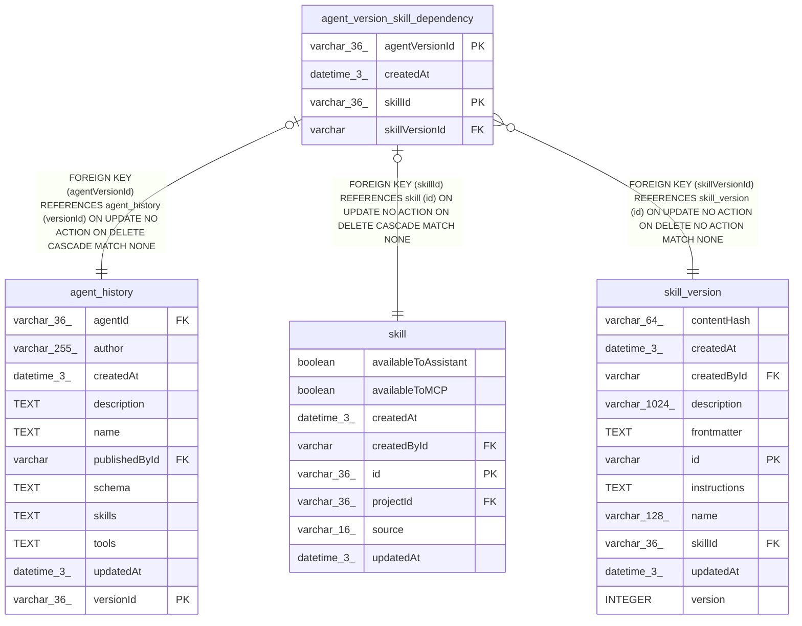

# agent_version_skill_dependency

## Description

<details>
<summary><strong>Table Definition</strong></summary>

```sql
CREATE TABLE "agent_version_skill_dependency" ("agentVersionId" varchar(36) NOT NULL, "skillId" varchar(36) NOT NULL, "skillVersionId" varchar NOT NULL, "createdAt" datetime(3) NOT NULL DEFAULT (STRFTIME('%Y-%m-%d %H:%M:%f', 'NOW')), CONSTRAINT "FK_97472baf9196d914d9cd9de6201" FOREIGN KEY ("agentVersionId") REFERENCES "agent_history" ("versionId") ON DELETE CASCADE, CONSTRAINT "FK_c494292243a7e510acd0331c3d1" FOREIGN KEY ("skillId") REFERENCES "skill" ("id") ON DELETE CASCADE, CONSTRAINT "FK_df63badfd7d3f2aa622ece471c4" FOREIGN KEY ("skillVersionId") REFERENCES "skill_version" ("id") ON DELETE NO ACTION, PRIMARY KEY ("agentVersionId", "skillId"))
```

</details>

## Columns

| Name | Type | Default | Nullable | Children | Parents | Comment |
| ---- | ---- | ------- | -------- | -------- | ------- | ------- |
| agentVersionId | varchar(36) |  | false |  | [agent_history](agent_history.md) |  |
| createdAt | datetime(3) | STRFTIME('%Y-%m-%d %H:%M:%f', 'NOW') | false |  |  |  |
| skillId | varchar(36) |  | false |  | [skill](skill.md) |  |
| skillVersionId | varchar |  | false |  | [skill_version](skill_version.md) |  |

## Constraints

| Name | Type | Definition |
| ---- | ---- | ---------- |
| - (Foreign key ID: 0) | FOREIGN KEY | FOREIGN KEY (skillVersionId) REFERENCES skill_version (id) ON UPDATE NO ACTION ON DELETE NO ACTION MATCH NONE |
| - (Foreign key ID: 1) | FOREIGN KEY | FOREIGN KEY (skillId) REFERENCES skill (id) ON UPDATE NO ACTION ON DELETE CASCADE MATCH NONE |
| - (Foreign key ID: 2) | FOREIGN KEY | FOREIGN KEY (agentVersionId) REFERENCES agent_history (versionId) ON UPDATE NO ACTION ON DELETE CASCADE MATCH NONE |
| agentVersionId | PRIMARY KEY | PRIMARY KEY (agentVersionId) |
| skillId | PRIMARY KEY | PRIMARY KEY (skillId) |
| sqlite_autoindex_agent_version_skill_dependency_1 | PRIMARY KEY | PRIMARY KEY (agentVersionId, skillId) |

## Indexes

| Name | Definition |
| ---- | ---------- |
| IDX_c494292243a7e510acd0331c3d | CREATE INDEX "IDX_c494292243a7e510acd0331c3d" ON "agent_version_skill_dependency" ("skillId")  |
| IDX_df63badfd7d3f2aa622ece471c | CREATE INDEX "IDX_df63badfd7d3f2aa622ece471c" ON "agent_version_skill_dependency" ("skillVersionId")  |
| sqlite_autoindex_agent_version_skill_dependency_1 | PRIMARY KEY (agentVersionId, skillId) |

## Relations



---

> Generated by [tbls](https://github.com/k1LoW/tbls)
