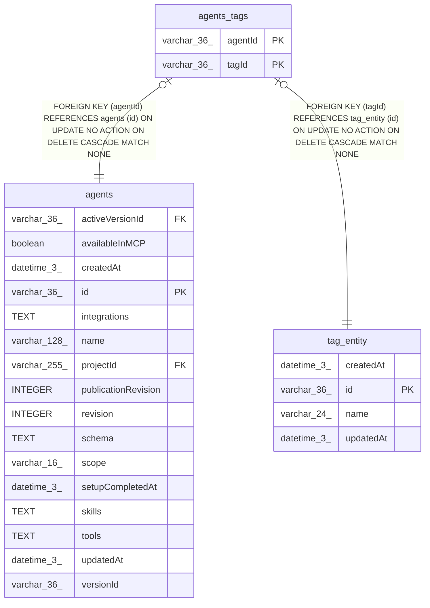

# agents_tags

## Description

<details>
<summary><strong>Table Definition</strong></summary>

```sql
CREATE TABLE "agents_tags" ("agentId" varchar(36) NOT NULL, "tagId" varchar(36) NOT NULL, CONSTRAINT "FK_bfc8a1ea9f09d842c53a5a781a2" FOREIGN KEY ("agentId") REFERENCES "agents" ("id") ON DELETE CASCADE, CONSTRAINT "FK_330ed9e51d337fe4b4a4ba63aa3" FOREIGN KEY ("tagId") REFERENCES "tag_entity" ("id") ON DELETE CASCADE, PRIMARY KEY ("agentId", "tagId"))
```

</details>

## Columns

| Name | Type | Default | Nullable | Children | Parents | Comment |
| ---- | ---- | ------- | -------- | -------- | ------- | ------- |
| agentId | varchar(36) |  | false |  | [agents](agents.md) |  |
| tagId | varchar(36) |  | false |  | [tag_entity](tag_entity.md) |  |

## Constraints

| Name | Type | Definition |
| ---- | ---- | ---------- |
| - (Foreign key ID: 0) | FOREIGN KEY | FOREIGN KEY (tagId) REFERENCES tag_entity (id) ON UPDATE NO ACTION ON DELETE CASCADE MATCH NONE |
| - (Foreign key ID: 1) | FOREIGN KEY | FOREIGN KEY (agentId) REFERENCES agents (id) ON UPDATE NO ACTION ON DELETE CASCADE MATCH NONE |
| agentId | PRIMARY KEY | PRIMARY KEY (agentId) |
| sqlite_autoindex_agents_tags_1 | PRIMARY KEY | PRIMARY KEY (agentId, tagId) |
| tagId | PRIMARY KEY | PRIMARY KEY (tagId) |

## Indexes

| Name | Definition |
| ---- | ---------- |
| IDX_330ed9e51d337fe4b4a4ba63aa | CREATE INDEX "IDX_330ed9e51d337fe4b4a4ba63aa" ON "agents_tags" ("tagId")  |
| sqlite_autoindex_agents_tags_1 | PRIMARY KEY (agentId, tagId) |

## Relations



---

> Generated by [tbls](https://github.com/k1LoW/tbls)
