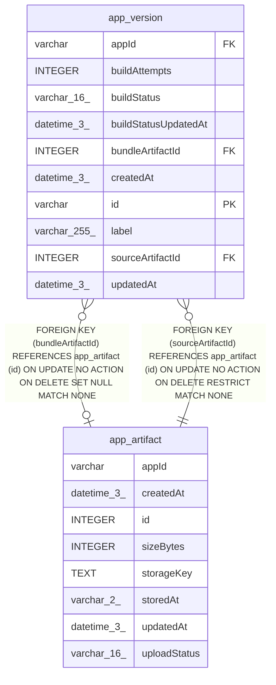

# app_artifact

## Description

<details>
<summary><strong>Table Definition</strong></summary>

```sql
CREATE TABLE "app_artifact" ("id" integer PRIMARY KEY NOT NULL, "appId" varchar NOT NULL, "storedAt" varchar(2) NOT NULL, "storageKey" text NOT NULL, "sizeBytes" integer NOT NULL, "uploadStatus" varchar(16) NOT NULL DEFAULT ('pending'), "createdAt" datetime(3) NOT NULL DEFAULT (STRFTIME('%Y-%m-%d %H:%M:%f', 'NOW')), "updatedAt" datetime(3) NOT NULL DEFAULT (STRFTIME('%Y-%m-%d %H:%M:%f', 'NOW')), CONSTRAINT "CHK_app_artifact_storedAt" CHECK ("storedAt" IN ('db', 'fs', 's3', 'az')), CONSTRAINT "CHK_app_artifact_uploadStatus" CHECK ("uploadStatus" IN ('pending', 'completed')))
```

</details>

## Columns

| Name | Type | Default | Nullable | Children | Parents | Comment |
| ---- | ---- | ------- | -------- | -------- | ------- | ------- |
| appId | varchar |  | false |  |  |  |
| createdAt | datetime(3) | STRFTIME('%Y-%m-%d %H:%M:%f', 'NOW') | false |  |  |  |
| id | INTEGER |  | false | [app_version](app_version.md) |  |  |
| sizeBytes | INTEGER |  | false |  |  |  |
| storageKey | TEXT |  | false |  |  |  |
| storedAt | varchar(2) |  | false |  |  |  |
| updatedAt | datetime(3) | STRFTIME('%Y-%m-%d %H:%M:%f', 'NOW') | false |  |  |  |
| uploadStatus | varchar(16) | 'pending' | false |  |  |  |

## Constraints

| Name | Type | Definition |
| ---- | ---- | ---------- |
| - | CHECK | CHECK ("storedAt" IN ('db', 'fs', 's3', 'az')) |
| - | CHECK | CHECK ("uploadStatus" IN ('pending', 'completed')) |
| id | PRIMARY KEY | PRIMARY KEY (id) |

## Relations



---

> Generated by [tbls](https://github.com/k1LoW/tbls)
