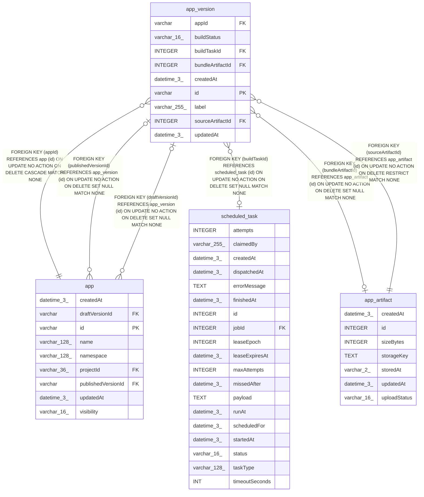

# app_version

## Description

<details>
<summary><strong>Table Definition</strong></summary>

```sql
CREATE TABLE "app_version" ("id" varchar PRIMARY KEY NOT NULL, "appId" varchar NOT NULL, "label" varchar(255), "sourceArtifactId" integer NOT NULL, "bundleArtifactId" integer, "buildTaskId" integer, "buildStatus" varchar(16) NOT NULL DEFAULT ('queued'), "createdAt" datetime(3) NOT NULL DEFAULT (STRFTIME('%Y-%m-%d %H:%M:%f', 'NOW')), "updatedAt" datetime(3) NOT NULL DEFAULT (STRFTIME('%Y-%m-%d %H:%M:%f', 'NOW')), CONSTRAINT "CHK_app_version_buildStatus" CHECK ("buildStatus" IN ('queued', 'running', 'succeeded', 'failed')), CONSTRAINT "FK_e9aeab5b1db8dc77708231ae44e" FOREIGN KEY ("appId") REFERENCES "app" ("id") ON DELETE CASCADE, CONSTRAINT "FK_9f1db6f02f5a0d1ae2f2b41a327" FOREIGN KEY ("sourceArtifactId") REFERENCES "app_artifact" ("id") ON DELETE RESTRICT, CONSTRAINT "FK_2ab536cbf97d71bad59517afee5" FOREIGN KEY ("bundleArtifactId") REFERENCES "app_artifact" ("id") ON DELETE SET NULL, CONSTRAINT "FK_93f7f9719991a7e6c3ebd93145a" FOREIGN KEY ("buildTaskId") REFERENCES "scheduled_task" ("id") ON DELETE SET NULL)
```

</details>

## Columns

| Name | Type | Default | Nullable | Children | Parents | Comment |
| ---- | ---- | ------- | -------- | -------- | ------- | ------- |
| appId | varchar |  | false |  | [app](app.md) |  |
| buildStatus | varchar(16) | 'queued' | false |  |  |  |
| buildTaskId | INTEGER |  | true |  | [scheduled_task](scheduled_task.md) |  |
| bundleArtifactId | INTEGER |  | true |  | [app_artifact](app_artifact.md) |  |
| createdAt | datetime(3) | STRFTIME('%Y-%m-%d %H:%M:%f', 'NOW') | false |  |  |  |
| id | varchar |  | false | [app](app.md) |  |  |
| label | varchar(255) |  | true |  |  |  |
| sourceArtifactId | INTEGER |  | false |  | [app_artifact](app_artifact.md) |  |
| updatedAt | datetime(3) | STRFTIME('%Y-%m-%d %H:%M:%f', 'NOW') | false |  |  |  |

## Constraints

| Name | Type | Definition |
| ---- | ---- | ---------- |
| - | CHECK | CHECK ("buildStatus" IN ('queued', 'running', 'succeeded', 'failed')) |
| - (Foreign key ID: 0) | FOREIGN KEY | FOREIGN KEY (buildTaskId) REFERENCES scheduled_task (id) ON UPDATE NO ACTION ON DELETE SET NULL MATCH NONE |
| - (Foreign key ID: 1) | FOREIGN KEY | FOREIGN KEY (bundleArtifactId) REFERENCES app_artifact (id) ON UPDATE NO ACTION ON DELETE SET NULL MATCH NONE |
| - (Foreign key ID: 2) | FOREIGN KEY | FOREIGN KEY (sourceArtifactId) REFERENCES app_artifact (id) ON UPDATE NO ACTION ON DELETE RESTRICT MATCH NONE |
| - (Foreign key ID: 3) | FOREIGN KEY | FOREIGN KEY (appId) REFERENCES app (id) ON UPDATE NO ACTION ON DELETE CASCADE MATCH NONE |
| id | PRIMARY KEY | PRIMARY KEY (id) |
| sqlite_autoindex_app_version_1 | PRIMARY KEY | PRIMARY KEY (id) |

## Indexes

| Name | Definition |
| ---- | ---------- |
| IDX_2ab536cbf97d71bad59517afee | CREATE INDEX "IDX_2ab536cbf97d71bad59517afee" ON "app_version" ("bundleArtifactId")  |
| IDX_93f7f9719991a7e6c3ebd93145 | CREATE INDEX "IDX_93f7f9719991a7e6c3ebd93145" ON "app_version" ("buildTaskId")  |
| IDX_9f1db6f02f5a0d1ae2f2b41a32 | CREATE INDEX "IDX_9f1db6f02f5a0d1ae2f2b41a32" ON "app_version" ("sourceArtifactId")  |
| IDX_e9aeab5b1db8dc77708231ae44 | CREATE INDEX "IDX_e9aeab5b1db8dc77708231ae44" ON "app_version" ("appId")  |
| sqlite_autoindex_app_version_1 | PRIMARY KEY (id) |

## Relations



---

> Generated by [tbls](https://github.com/k1LoW/tbls)
