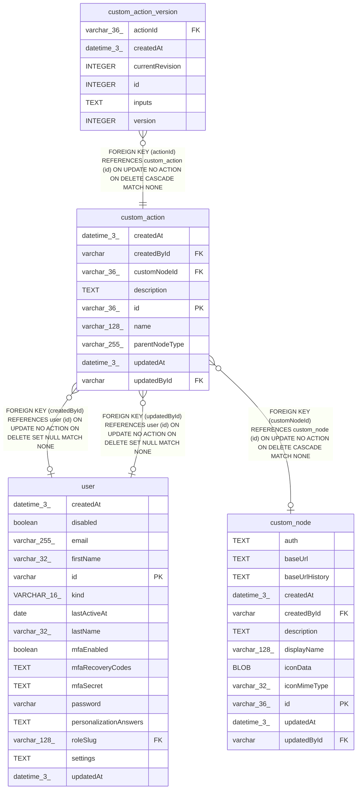

# custom_action

## Description

<details>
<summary><strong>Table Definition</strong></summary>

```sql
CREATE TABLE "custom_action" ("id" varchar(36) PRIMARY KEY NOT NULL, "name" varchar(128) NOT NULL, "description" text, "parentNodeType" varchar(255), "customNodeId" varchar(36), "createdById" varchar, "updatedById" varchar, "createdAt" datetime(3) NOT NULL DEFAULT (STRFTIME('%Y-%m-%d %H:%M:%f', 'NOW')), "updatedAt" datetime(3) NOT NULL DEFAULT (STRFTIME('%Y-%m-%d %H:%M:%f', 'NOW')), CONSTRAINT "CHK_custom_action_parent" CHECK (("parentNodeType" IS NOT NULL AND "customNodeId" IS NULL) OR ("parentNodeType" IS NULL AND "customNodeId" IS NOT NULL)), CONSTRAINT "FK_3a035fafb41c019cd30a18c7d64" FOREIGN KEY ("customNodeId") REFERENCES "custom_node" ("id") ON DELETE CASCADE, CONSTRAINT "FK_b727a942323fc5b00ea3ddcbe55" FOREIGN KEY ("createdById") REFERENCES "user" ("id") ON DELETE SET NULL, CONSTRAINT "FK_d362f7764fba8a99c24fa090ba8" FOREIGN KEY ("updatedById") REFERENCES "user" ("id") ON DELETE SET NULL)
```

</details>

## Columns

| Name | Type | Default | Nullable | Children | Parents | Comment |
| ---- | ---- | ------- | -------- | -------- | ------- | ------- |
| createdAt | datetime(3) | STRFTIME('%Y-%m-%d %H:%M:%f', 'NOW') | false |  |  |  |
| createdById | varchar |  | true |  | [user](user.md) |  |
| customNodeId | varchar(36) |  | true |  | [custom_node](custom_node.md) |  |
| description | TEXT |  | true |  |  |  |
| id | varchar(36) |  | false | [custom_action_version](custom_action_version.md) |  |  |
| name | varchar(128) |  | false |  |  |  |
| parentNodeType | varchar(255) |  | true |  |  |  |
| updatedAt | datetime(3) | STRFTIME('%Y-%m-%d %H:%M:%f', 'NOW') | false |  |  |  |
| updatedById | varchar |  | true |  | [user](user.md) |  |

## Constraints

| Name | Type | Definition |
| ---- | ---- | ---------- |
| - | CHECK | CHECK (("parentNodeType" IS NOT NULL AND "customNodeId" IS NULL) OR ("parentNodeType" IS NULL AND "customNodeId" IS NOT NULL)) |
| - (Foreign key ID: 0) | FOREIGN KEY | FOREIGN KEY (updatedById) REFERENCES user (id) ON UPDATE NO ACTION ON DELETE SET NULL MATCH NONE |
| - (Foreign key ID: 1) | FOREIGN KEY | FOREIGN KEY (createdById) REFERENCES user (id) ON UPDATE NO ACTION ON DELETE SET NULL MATCH NONE |
| - (Foreign key ID: 2) | FOREIGN KEY | FOREIGN KEY (customNodeId) REFERENCES custom_node (id) ON UPDATE NO ACTION ON DELETE CASCADE MATCH NONE |
| id | PRIMARY KEY | PRIMARY KEY (id) |
| sqlite_autoindex_custom_action_1 | PRIMARY KEY | PRIMARY KEY (id) |

## Indexes

| Name | Definition |
| ---- | ---------- |
| IDX_22700f189b1c75a496129b4ce7 | CREATE INDEX "IDX_22700f189b1c75a496129b4ce7" ON "custom_action" ("parentNodeType")  |
| IDX_3a035fafb41c019cd30a18c7d6 | CREATE INDEX "IDX_3a035fafb41c019cd30a18c7d6" ON "custom_action" ("customNodeId")  |
| IDX_b727a942323fc5b00ea3ddcbe5 | CREATE INDEX "IDX_b727a942323fc5b00ea3ddcbe5" ON "custom_action" ("createdById")  |
| IDX_d362f7764fba8a99c24fa090ba | CREATE INDEX "IDX_d362f7764fba8a99c24fa090ba" ON "custom_action" ("updatedById")  |
| sqlite_autoindex_custom_action_1 | PRIMARY KEY (id) |

## Relations



---

> Generated by [tbls](https://github.com/k1LoW/tbls)
