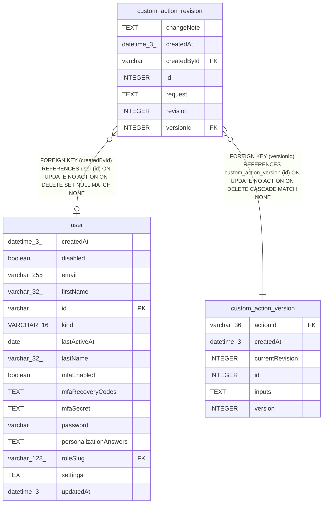

# custom_action_revision

## Description

<details>
<summary><strong>Table Definition</strong></summary>

```sql
CREATE TABLE "custom_action_revision" ("id" integer PRIMARY KEY NOT NULL, "versionId" integer NOT NULL, "revision" integer NOT NULL, "request" text NOT NULL, "changeNote" text, "createdById" varchar, "createdAt" datetime(3) NOT NULL DEFAULT (STRFTIME('%Y-%m-%d %H:%M:%f', 'NOW')), CONSTRAINT "FK_907abd1deb7ca98701bedbc0972" FOREIGN KEY ("versionId") REFERENCES "custom_action_version" ("id") ON DELETE CASCADE, CONSTRAINT "FK_9b6c94576c09f1dfe02f7a10acb" FOREIGN KEY ("createdById") REFERENCES "user" ("id") ON DELETE SET NULL)
```

</details>

## Columns

| Name | Type | Default | Nullable | Children | Parents | Comment |
| ---- | ---- | ------- | -------- | -------- | ------- | ------- |
| changeNote | TEXT |  | true |  |  |  |
| createdAt | datetime(3) | STRFTIME('%Y-%m-%d %H:%M:%f', 'NOW') | false |  |  |  |
| createdById | varchar |  | true |  | [user](user.md) |  |
| id | INTEGER |  | false |  |  |  |
| request | TEXT |  | false |  |  |  |
| revision | INTEGER |  | false |  |  |  |
| versionId | INTEGER |  | false |  | [custom_action_version](custom_action_version.md) |  |

## Constraints

| Name | Type | Definition |
| ---- | ---- | ---------- |
| - (Foreign key ID: 0) | FOREIGN KEY | FOREIGN KEY (createdById) REFERENCES user (id) ON UPDATE NO ACTION ON DELETE SET NULL MATCH NONE |
| - (Foreign key ID: 1) | FOREIGN KEY | FOREIGN KEY (versionId) REFERENCES custom_action_version (id) ON UPDATE NO ACTION ON DELETE CASCADE MATCH NONE |
| id | PRIMARY KEY | PRIMARY KEY (id) |

## Indexes

| Name | Definition |
| ---- | ---------- |
| IDX_9b6c94576c09f1dfe02f7a10ac | CREATE INDEX "IDX_9b6c94576c09f1dfe02f7a10ac" ON "custom_action_revision" ("createdById")  |
| IDX_fa5ac3f69d61ac6e758bbcc50b | CREATE UNIQUE INDEX "IDX_fa5ac3f69d61ac6e758bbcc50b" ON "custom_action_revision" ("versionId", "revision")  |

## Relations



---

> Generated by [tbls](https://github.com/k1LoW/tbls)
