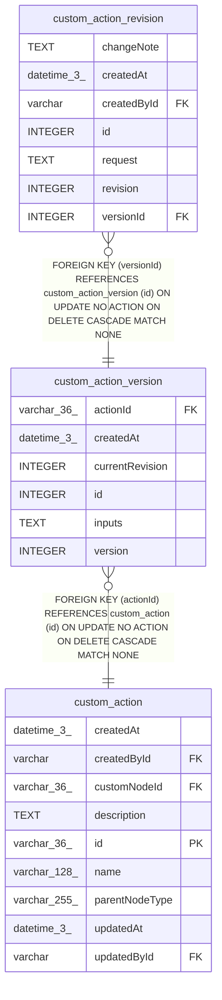

# custom_action_version

## Description

<details>
<summary><strong>Table Definition</strong></summary>

```sql
CREATE TABLE "custom_action_version" ("id" integer PRIMARY KEY NOT NULL, "actionId" varchar(36) NOT NULL, "version" integer NOT NULL, "inputs" text NOT NULL, "currentRevision" integer NOT NULL, "createdAt" datetime(3) NOT NULL DEFAULT (STRFTIME('%Y-%m-%d %H:%M:%f', 'NOW')), CONSTRAINT "FK_d7e1a3ea1ddb3a45448d5d5f9e4" FOREIGN KEY ("actionId") REFERENCES "custom_action" ("id") ON DELETE CASCADE)
```

</details>

## Columns

| Name | Type | Default | Nullable | Children | Parents | Comment |
| ---- | ---- | ------- | -------- | -------- | ------- | ------- |
| actionId | varchar(36) |  | false |  | [custom_action](custom_action.md) |  |
| createdAt | datetime(3) | STRFTIME('%Y-%m-%d %H:%M:%f', 'NOW') | false |  |  |  |
| currentRevision | INTEGER |  | false |  |  |  |
| id | INTEGER |  | false | [custom_action_revision](custom_action_revision.md) |  |  |
| inputs | TEXT |  | false |  |  |  |
| version | INTEGER |  | false |  |  |  |

## Constraints

| Name | Type | Definition |
| ---- | ---- | ---------- |
| - (Foreign key ID: 0) | FOREIGN KEY | FOREIGN KEY (actionId) REFERENCES custom_action (id) ON UPDATE NO ACTION ON DELETE CASCADE MATCH NONE |
| id | PRIMARY KEY | PRIMARY KEY (id) |

## Indexes

| Name | Definition |
| ---- | ---------- |
| IDX_f5e563b87c510a9af5f3f086b5 | CREATE UNIQUE INDEX "IDX_f5e563b87c510a9af5f3f086b5" ON "custom_action_version" ("actionId", "version")  |

## Relations



---

> Generated by [tbls](https://github.com/k1LoW/tbls)
