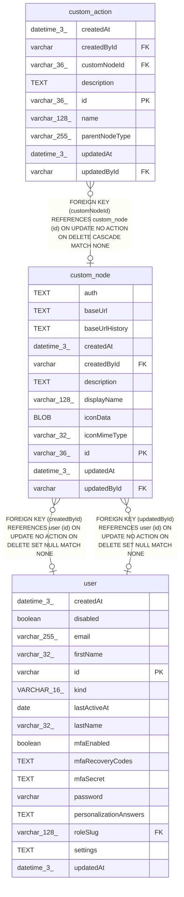

# custom_node

## Description

<details>
<summary><strong>Table Definition</strong></summary>

```sql
CREATE TABLE "custom_node" ("id" varchar(36) PRIMARY KEY NOT NULL, "displayName" varchar(128) NOT NULL, "description" text, "baseUrl" text NOT NULL, "baseUrlHistory" text NOT NULL DEFAULT ('[]'), "auth" text NOT NULL, "iconMimeType" varchar(32), "iconData" blob, "createdById" varchar, "updatedById" varchar, "createdAt" datetime(3) NOT NULL DEFAULT (STRFTIME('%Y-%m-%d %H:%M:%f', 'NOW')), "updatedAt" datetime(3) NOT NULL DEFAULT (STRFTIME('%Y-%m-%d %H:%M:%f', 'NOW')), CONSTRAINT "CHK_custom_node_iconMimeType" CHECK ("iconMimeType" IN ('image/png', 'image/svg+xml')), CONSTRAINT "FK_6aeb42fe6cec12e0fdfcc8ba764" FOREIGN KEY ("createdById") REFERENCES "user" ("id") ON DELETE SET NULL, CONSTRAINT "FK_9854fde40fc84bbeeef603feaf2" FOREIGN KEY ("updatedById") REFERENCES "user" ("id") ON DELETE SET NULL)
```

</details>

## Columns

| Name | Type | Default | Nullable | Children | Parents | Comment |
| ---- | ---- | ------- | -------- | -------- | ------- | ------- |
| auth | TEXT |  | false |  |  |  |
| baseUrl | TEXT |  | false |  |  |  |
| baseUrlHistory | TEXT | '[]' | false |  |  |  |
| createdAt | datetime(3) | STRFTIME('%Y-%m-%d %H:%M:%f', 'NOW') | false |  |  |  |
| createdById | varchar |  | true |  | [user](user.md) |  |
| description | TEXT |  | true |  |  |  |
| displayName | varchar(128) |  | false |  |  |  |
| iconData | BLOB |  | true |  |  |  |
| iconMimeType | varchar(32) |  | true |  |  |  |
| id | varchar(36) |  | false | [custom_action](custom_action.md) |  |  |
| updatedAt | datetime(3) | STRFTIME('%Y-%m-%d %H:%M:%f', 'NOW') | false |  |  |  |
| updatedById | varchar |  | true |  | [user](user.md) |  |

## Constraints

| Name | Type | Definition |
| ---- | ---- | ---------- |
| - | CHECK | CHECK ("iconMimeType" IN ('image/png', 'image/svg+xml')) |
| - (Foreign key ID: 0) | FOREIGN KEY | FOREIGN KEY (updatedById) REFERENCES user (id) ON UPDATE NO ACTION ON DELETE SET NULL MATCH NONE |
| - (Foreign key ID: 1) | FOREIGN KEY | FOREIGN KEY (createdById) REFERENCES user (id) ON UPDATE NO ACTION ON DELETE SET NULL MATCH NONE |
| id | PRIMARY KEY | PRIMARY KEY (id) |
| sqlite_autoindex_custom_node_1 | PRIMARY KEY | PRIMARY KEY (id) |

## Indexes

| Name | Definition |
| ---- | ---------- |
| IDX_6aeb42fe6cec12e0fdfcc8ba76 | CREATE INDEX "IDX_6aeb42fe6cec12e0fdfcc8ba76" ON "custom_node" ("createdById")  |
| IDX_9854fde40fc84bbeeef603feaf | CREATE INDEX "IDX_9854fde40fc84bbeeef603feaf" ON "custom_node" ("updatedById")  |
| sqlite_autoindex_custom_node_1 | PRIMARY KEY (id) |

## Relations



---

> Generated by [tbls](https://github.com/k1LoW/tbls)
