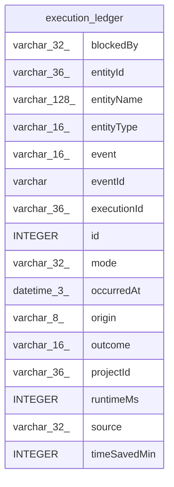

# execution_ledger

## Description

<details>
<summary><strong>Table Definition</strong></summary>

```sql
CREATE TABLE "execution_ledger" ("id" integer PRIMARY KEY AUTOINCREMENT NOT NULL, "executionId" varchar(36) NOT NULL, "occurredAt" datetime(3) NOT NULL, "entityType" varchar(16) NOT NULL, "entityName" varchar(128) NOT NULL, "entityId" varchar(36) NOT NULL, "projectId" varchar(36) NOT NULL, "mode" varchar(32) NOT NULL, "source" varchar(32) NOT NULL DEFAULT ('none'), "event" varchar(16) NOT NULL, "outcome" varchar(16) NOT NULL, "blockedBy" varchar(32) NOT NULL DEFAULT ('none'), "runtimeMs" integer NOT NULL DEFAULT (0), "timeSavedMin" integer NOT NULL DEFAULT (0), "origin" varchar(8) NOT NULL, "eventId" varchar NOT NULL, CONSTRAINT "CHK_execution_ledger_started_outcome" CHECK (("event" = 'started' AND "outcome" = 'none') OR ("event" = 'ended' AND "outcome" <> 'none')), CONSTRAINT "CHK_execution_ledger_blocked_reason" CHECK (("outcome" = 'blocked' AND "blockedBy" <> 'none') OR ("outcome" <> 'blocked' AND "blockedBy" = 'none')), CONSTRAINT "CHK_execution_ledger_entityType" CHECK ("entityType" IN ('workflow', 'agent')), CONSTRAINT "CHK_execution_ledger_event" CHECK ("event" IN ('started', 'ended')), CONSTRAINT "CHK_execution_ledger_outcome" CHECK ("outcome" IN ('none', 'success', 'error', 'crashed', 'canceled', 'blocked')), CONSTRAINT "CHK_execution_ledger_blockedBy" CHECK ("blockedBy" IN ('none', 'policy', 'credentialAccess', 'invalidWorkflow', 'contextHook', 'startFailed')), CONSTRAINT "CHK_execution_ledger_origin" CHECK ("origin" IN ('v1', 'v2')))
```

</details>

## Columns

| Name | Type | Default | Nullable | Children | Parents | Comment |
| ---- | ---- | ------- | -------- | -------- | ------- | ------- |
| blockedBy | varchar(32) | 'none' | false |  |  |  |
| entityId | varchar(36) |  | false |  |  |  |
| entityName | varchar(128) |  | false |  |  |  |
| entityType | varchar(16) |  | false |  |  |  |
| event | varchar(16) |  | false |  |  |  |
| eventId | varchar |  | false |  |  |  |
| executionId | varchar(36) |  | false |  |  |  |
| id | INTEGER |  | false |  |  |  |
| mode | varchar(32) |  | false |  |  |  |
| occurredAt | datetime(3) |  | false |  |  |  |
| origin | varchar(8) |  | false |  |  |  |
| outcome | varchar(16) |  | false |  |  |  |
| projectId | varchar(36) |  | false |  |  |  |
| runtimeMs | INTEGER | 0 | false |  |  |  |
| source | varchar(32) | 'none' | false |  |  |  |
| timeSavedMin | INTEGER | 0 | false |  |  |  |

## Constraints

| Name | Type | Definition |
| ---- | ---- | ---------- |
| - | CHECK | CHECK (("event" = 'started' AND "outcome" = 'none') OR ("event" = 'ended' AND "outcome" <> 'none')) |
| - | CHECK | CHECK (("outcome" = 'blocked' AND "blockedBy" <> 'none') OR ("outcome" <> 'blocked' AND "blockedBy" = 'none')) |
| - | CHECK | CHECK ("entityType" IN ('workflow', 'agent')) |
| - | CHECK | CHECK ("event" IN ('started', 'ended')) |
| - | CHECK | CHECK ("outcome" IN ('none', 'success', 'error', 'crashed', 'canceled', 'blocked')) |
| - | CHECK | CHECK ("blockedBy" IN ('none', 'policy', 'credentialAccess', 'invalidWorkflow', 'contextHook', 'startFailed')) |
| - | CHECK | CHECK ("origin" IN ('v1', 'v2')) |
| id | PRIMARY KEY | PRIMARY KEY (id) |

## Relations



---

> Generated by [tbls](https://github.com/k1LoW/tbls)
