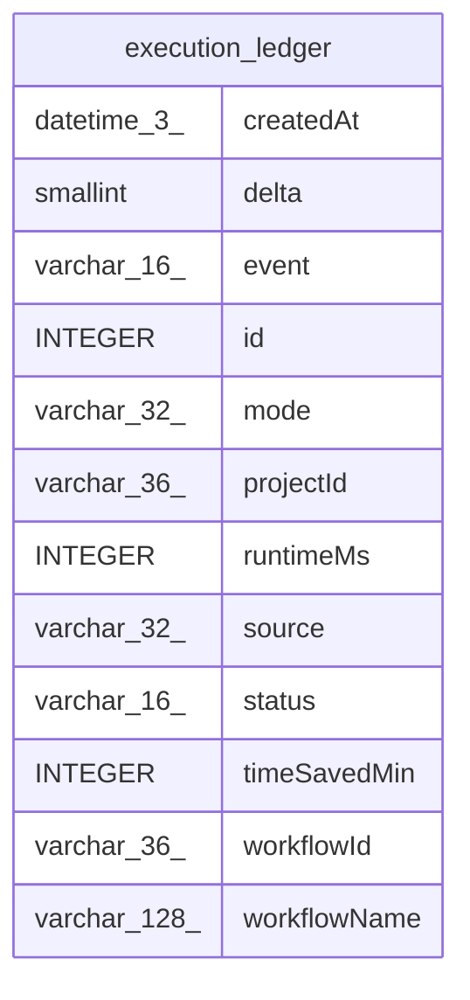

# execution_ledger

## Description

<details>
<summary><strong>Table Definition</strong></summary>

```sql
CREATE TABLE "execution_ledger" (
				"id" integer PRIMARY KEY AUTOINCREMENT NOT NULL,
				"event" varchar(16) NOT NULL CHECK ("event" IN ('started', 'finished')),
				"workflowId" varchar(36) NOT NULL,
				"projectId" varchar(36),
				"workflowName" varchar(128),
				"mode" varchar(32) NOT NULL,
				"status" varchar(16),
				"source" varchar(32),
				"delta" smallint NOT NULL DEFAULT 1,
				"runtimeMs" integer,
				"timeSavedMin" integer,
				"createdAt" datetime(3) NOT NULL DEFAULT (STRFTIME('%Y-%m-%d %H:%M:%f', 'NOW'))
			)
```

</details>

## Columns

| Name | Type | Default | Nullable | Children | Parents | Comment |
| ---- | ---- | ------- | -------- | -------- | ------- | ------- |
| createdAt | datetime(3) | STRFTIME('%Y-%m-%d %H:%M:%f', 'NOW') | false |  |  |  |
| delta | smallint | 1 | false |  |  |  |
| event | varchar(16) |  | false |  |  |  |
| id | INTEGER |  | false |  |  |  |
| mode | varchar(32) |  | false |  |  |  |
| projectId | varchar(36) |  | true |  |  |  |
| runtimeMs | INTEGER |  | true |  |  |  |
| source | varchar(32) |  | true |  |  |  |
| status | varchar(16) |  | true |  |  |  |
| timeSavedMin | INTEGER |  | true |  |  |  |
| workflowId | varchar(36) |  | false |  |  |  |
| workflowName | varchar(128) |  | true |  |  |  |

## Constraints

| Name | Type | Definition |
| ---- | ---- | ---------- |
| - | CHECK | CHECK ("event" IN ('started', 'finished')) |
| id | PRIMARY KEY | PRIMARY KEY (id) |

## Relations



---

> Generated by [tbls](https://github.com/k1LoW/tbls)
