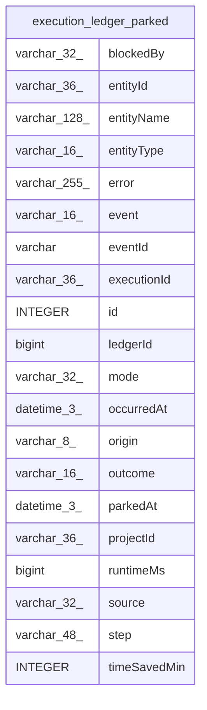

# execution_ledger_parked

## Description

<details>
<summary><strong>Table Definition</strong></summary>

```sql
CREATE TABLE "execution_ledger_parked" ("id" integer PRIMARY KEY NOT NULL, "ledgerId" bigint NOT NULL, "step" varchar(48) NOT NULL, "error" varchar(255) NOT NULL, "parkedAt" datetime(3) NOT NULL, "executionId" varchar(36) NOT NULL, "occurredAt" datetime(3) NOT NULL, "entityType" varchar(16) NOT NULL, "entityName" varchar(128) NOT NULL, "entityId" varchar(36) NOT NULL, "projectId" varchar(36), "mode" varchar(32) NOT NULL, "source" varchar(32) NOT NULL, "event" varchar(16) NOT NULL, "outcome" varchar(16) NOT NULL, "blockedBy" varchar(32) NOT NULL, "runtimeMs" bigint NOT NULL, "timeSavedMin" integer NOT NULL, "origin" varchar(8) NOT NULL, "eventId" varchar NOT NULL)
```

</details>

## Columns

| Name | Type | Default | Nullable | Children | Parents | Comment |
| ---- | ---- | ------- | -------- | -------- | ------- | ------- |
| blockedBy | varchar(32) |  | false |  |  |  |
| entityId | varchar(36) |  | false |  |  |  |
| entityName | varchar(128) |  | false |  |  |  |
| entityType | varchar(16) |  | false |  |  |  |
| error | varchar(255) |  | false |  |  |  |
| event | varchar(16) |  | false |  |  |  |
| eventId | varchar |  | false |  |  |  |
| executionId | varchar(36) |  | false |  |  |  |
| id | INTEGER |  | false |  |  |  |
| ledgerId | bigint |  | false |  |  |  |
| mode | varchar(32) |  | false |  |  |  |
| occurredAt | datetime(3) |  | false |  |  |  |
| origin | varchar(8) |  | false |  |  |  |
| outcome | varchar(16) |  | false |  |  |  |
| parkedAt | datetime(3) |  | false |  |  |  |
| projectId | varchar(36) |  | true |  |  |  |
| runtimeMs | bigint |  | false |  |  |  |
| source | varchar(32) |  | false |  |  |  |
| step | varchar(48) |  | false |  |  |  |
| timeSavedMin | INTEGER |  | false |  |  |  |

## Constraints

| Name | Type | Definition |
| ---- | ---- | ---------- |
| id | PRIMARY KEY | PRIMARY KEY (id) |

## Indexes

| Name | Definition |
| ---- | ---------- |
| IDX_9d90aef512ab0433f8d442fe13 | CREATE UNIQUE INDEX "IDX_9d90aef512ab0433f8d442fe13" ON "execution_ledger_parked" ("step", "ledgerId")  |

## Relations



---

> Generated by [tbls](https://github.com/k1LoW/tbls)
