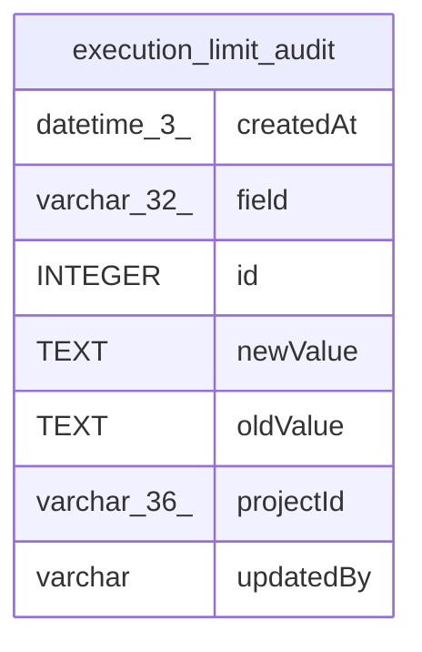

# execution_limit_audit

## Description

<details>
<summary><strong>Table Definition</strong></summary>

```sql
CREATE TABLE "execution_limit_audit" ("id" integer PRIMARY KEY NOT NULL, "projectId" varchar(36), "field" varchar(32) NOT NULL, "oldValue" text, "newValue" text, "updatedBy" varchar, "createdAt" datetime(3) NOT NULL DEFAULT (STRFTIME('%Y-%m-%d %H:%M:%f', 'NOW')), CONSTRAINT "CHK_execution_limit_audit_field" CHECK ("field" IN ('periodUnit', 'instanceMaxExecutions', 'defaultProjectMaxExecutions', 'projectMaxExecutions')))
```

</details>

## Columns

| Name | Type | Default | Nullable | Children | Parents | Comment |
| ---- | ---- | ------- | -------- | -------- | ------- | ------- |
| createdAt | datetime(3) | STRFTIME('%Y-%m-%d %H:%M:%f', 'NOW') | false |  |  |  |
| field | varchar(32) |  | false |  |  |  |
| id | INTEGER |  | false |  |  |  |
| newValue | TEXT |  | true |  |  |  |
| oldValue | TEXT |  | true |  |  |  |
| projectId | varchar(36) |  | true |  |  |  |
| updatedBy | varchar |  | true |  |  |  |

## Constraints

| Name | Type | Definition |
| ---- | ---- | ---------- |
| - | CHECK | CHECK ("field" IN ('periodUnit', 'instanceMaxExecutions', 'defaultProjectMaxExecutions', 'projectMaxExecutions')) |
| id | PRIMARY KEY | PRIMARY KEY (id) |

## Relations



---

> Generated by [tbls](https://github.com/k1LoW/tbls)
