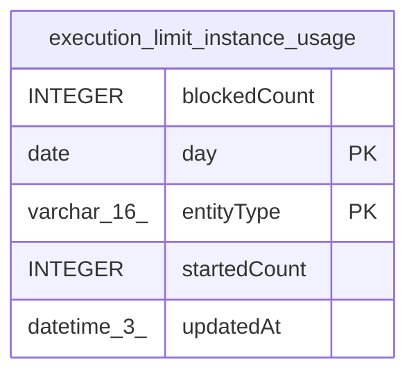

# execution_limit_instance_usage

## Description

<details>
<summary><strong>Table Definition</strong></summary>

```sql
CREATE TABLE "execution_limit_instance_usage" ("day" date NOT NULL, "entityType" varchar(16) NOT NULL, "startedCount" integer NOT NULL DEFAULT (0), "blockedCount" integer NOT NULL DEFAULT (0), "updatedAt" datetime(3) NOT NULL DEFAULT (STRFTIME('%Y-%m-%d %H:%M:%f', 'NOW')), CONSTRAINT "CHK_execution_limit_instance_usage_counts_non_negative" CHECK ("startedCount" >= 0 AND "blockedCount" >= 0), CONSTRAINT "CHK_execution_limit_instance_usage_entityType" CHECK ("entityType" IN ('workflow', 'agent')), PRIMARY KEY ("day", "entityType"))
```

</details>

## Columns

| Name | Type | Default | Nullable | Children | Parents | Comment |
| ---- | ---- | ------- | -------- | -------- | ------- | ------- |
| blockedCount | INTEGER | 0 | false |  |  |  |
| day | date |  | false |  |  |  |
| entityType | varchar(16) |  | false |  |  |  |
| startedCount | INTEGER | 0 | false |  |  |  |
| updatedAt | datetime(3) | STRFTIME('%Y-%m-%d %H:%M:%f', 'NOW') | false |  |  |  |

## Constraints

| Name | Type | Definition |
| ---- | ---- | ---------- |
| - | CHECK | CHECK ("startedCount" >= 0 AND "blockedCount" >= 0) |
| - | CHECK | CHECK ("entityType" IN ('workflow', 'agent')) |
| day | PRIMARY KEY | PRIMARY KEY (day) |
| entityType | PRIMARY KEY | PRIMARY KEY (entityType) |
| sqlite_autoindex_execution_limit_instance_usage_1 | PRIMARY KEY | PRIMARY KEY (day, entityType) |

## Indexes

| Name | Definition |
| ---- | ---------- |
| sqlite_autoindex_execution_limit_instance_usage_1 | PRIMARY KEY (day, entityType) |

## Relations



---

> Generated by [tbls](https://github.com/k1LoW/tbls)
