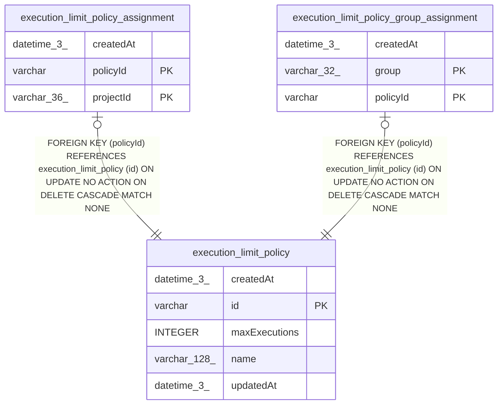

# execution_limit_policy

## Description

<details>
<summary><strong>Table Definition</strong></summary>

```sql
CREATE TABLE "execution_limit_policy" ("id" varchar PRIMARY KEY NOT NULL, "name" varchar(128) NOT NULL, "maxExecutions" integer NOT NULL, "createdAt" datetime(3) NOT NULL DEFAULT (STRFTIME('%Y-%m-%d %H:%M:%f', 'NOW')), "updatedAt" datetime(3) NOT NULL DEFAULT (STRFTIME('%Y-%m-%d %H:%M:%f', 'NOW')), CONSTRAINT "CHK_execution_limit_policy_max_executions_positive" CHECK ("maxExecutions" > 0))
```

</details>

## Columns

| Name | Type | Default | Nullable | Children | Parents | Comment |
| ---- | ---- | ------- | -------- | -------- | ------- | ------- |
| createdAt | datetime(3) | STRFTIME('%Y-%m-%d %H:%M:%f', 'NOW') | false |  |  |  |
| id | varchar |  | false | [execution_limit_policy_assignment](execution_limit_policy_assignment.md) [execution_limit_policy_group_assignment](execution_limit_policy_group_assignment.md) |  |  |
| maxExecutions | INTEGER |  | false |  |  |  |
| name | varchar(128) |  | false |  |  |  |
| updatedAt | datetime(3) | STRFTIME('%Y-%m-%d %H:%M:%f', 'NOW') | false |  |  |  |

## Constraints

| Name | Type | Definition |
| ---- | ---- | ---------- |
| - | CHECK | CHECK ("maxExecutions" > 0) |
| id | PRIMARY KEY | PRIMARY KEY (id) |
| sqlite_autoindex_execution_limit_policy_1 | PRIMARY KEY | PRIMARY KEY (id) |

## Indexes

| Name | Definition |
| ---- | ---------- |
| IDX_0371d0006540d54e0bf3b66041 | CREATE UNIQUE INDEX "IDX_0371d0006540d54e0bf3b66041" ON "execution_limit_policy" ("name")  |
| sqlite_autoindex_execution_limit_policy_1 | PRIMARY KEY (id) |

## Relations



---

> Generated by [tbls](https://github.com/k1LoW/tbls)
