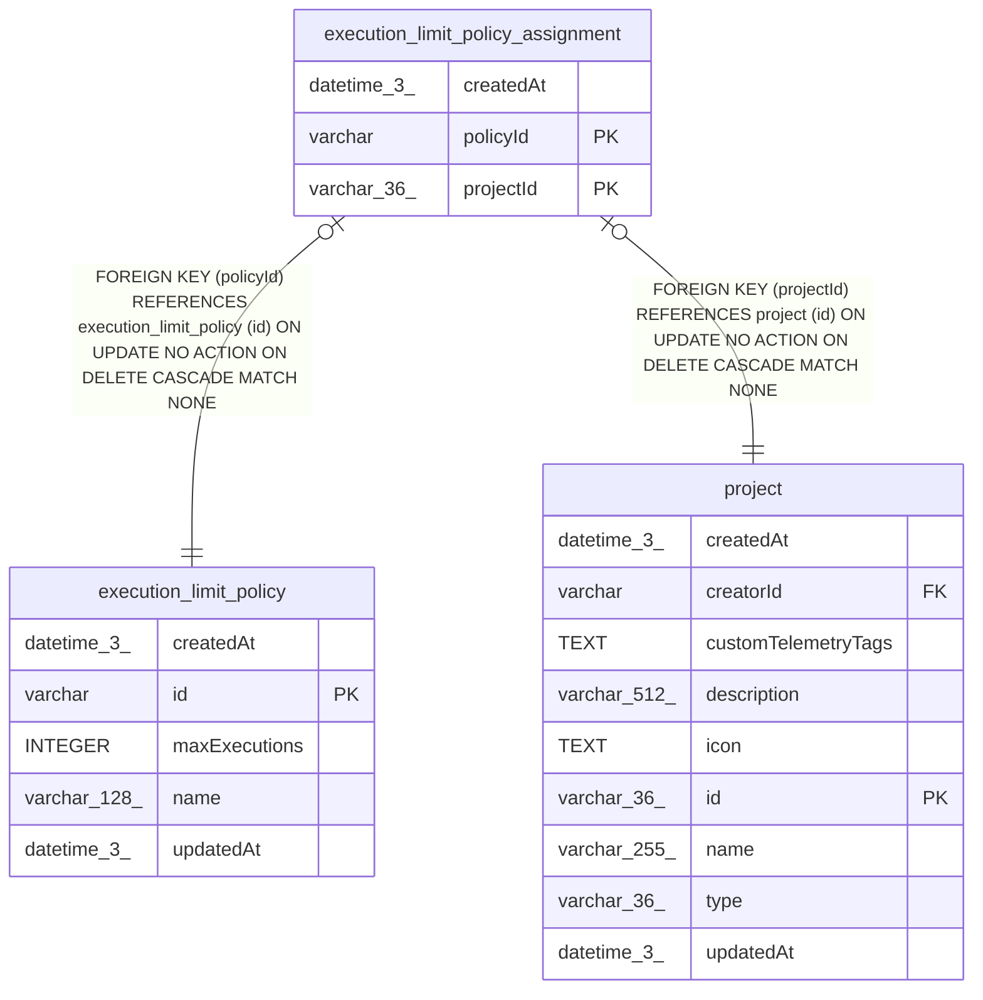

# execution_limit_policy_assignment

## Description

<details>
<summary><strong>Table Definition</strong></summary>

```sql
CREATE TABLE "execution_limit_policy_assignment" ("policyId" varchar NOT NULL, "projectId" varchar(36) NOT NULL, "createdAt" datetime(3) NOT NULL DEFAULT (STRFTIME('%Y-%m-%d %H:%M:%f', 'NOW')), CONSTRAINT "FK_a2068a7e0137ebddc1258078e38" FOREIGN KEY ("policyId") REFERENCES "execution_limit_policy" ("id") ON DELETE CASCADE, CONSTRAINT "FK_8e78454e151e273b43307b7c3ef" FOREIGN KEY ("projectId") REFERENCES "project" ("id") ON DELETE CASCADE, PRIMARY KEY ("policyId", "projectId"))
```

</details>

## Columns

| Name | Type | Default | Nullable | Children | Parents | Comment |
| ---- | ---- | ------- | -------- | -------- | ------- | ------- |
| createdAt | datetime(3) | STRFTIME('%Y-%m-%d %H:%M:%f', 'NOW') | false |  |  |  |
| policyId | varchar |  | false |  | [execution_limit_policy](execution_limit_policy.md) |  |
| projectId | varchar(36) |  | false |  | [project](project.md) |  |

## Constraints

| Name | Type | Definition |
| ---- | ---- | ---------- |
| - (Foreign key ID: 0) | FOREIGN KEY | FOREIGN KEY (projectId) REFERENCES project (id) ON UPDATE NO ACTION ON DELETE CASCADE MATCH NONE |
| - (Foreign key ID: 1) | FOREIGN KEY | FOREIGN KEY (policyId) REFERENCES execution_limit_policy (id) ON UPDATE NO ACTION ON DELETE CASCADE MATCH NONE |
| policyId | PRIMARY KEY | PRIMARY KEY (policyId) |
| projectId | PRIMARY KEY | PRIMARY KEY (projectId) |
| sqlite_autoindex_execution_limit_policy_assignment_1 | PRIMARY KEY | PRIMARY KEY (policyId, projectId) |

## Indexes

| Name | Definition |
| ---- | ---------- |
| IDX_8e78454e151e273b43307b7c3e | CREATE INDEX "IDX_8e78454e151e273b43307b7c3e" ON "execution_limit_policy_assignment" ("projectId")  |
| sqlite_autoindex_execution_limit_policy_assignment_1 | PRIMARY KEY (policyId, projectId) |

## Relations



---

> Generated by [tbls](https://github.com/k1LoW/tbls)
