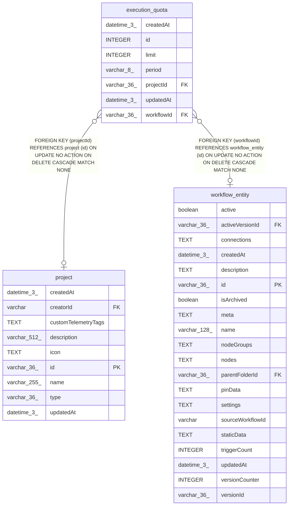

# execution_quota

## Description

<details>
<summary><strong>Table Definition</strong></summary>

```sql
CREATE TABLE "execution_quota" (
				"id" integer PRIMARY KEY AUTOINCREMENT NOT NULL,
				"workflowId" varchar(36) REFERENCES "workflow_entity" ("id") ON DELETE CASCADE,
				"projectId" varchar(36) REFERENCES "project" ("id") ON DELETE CASCADE,
				"period" varchar(8) NOT NULL CHECK ("period" IN ('day', 'month')),
				"limit" integer NOT NULL CHECK ("limit" >= 0),
				"createdAt" datetime(3) NOT NULL DEFAULT (STRFTIME('%Y-%m-%d %H:%M:%f', 'NOW')),
				"updatedAt" datetime(3) NOT NULL DEFAULT (STRFTIME('%Y-%m-%d %H:%M:%f', 'NOW')),
				CHECK (("workflowId" IS NULL) <> ("projectId" IS NULL))
			)
```

</details>

## Columns

| Name | Type | Default | Nullable | Children | Parents | Comment |
| ---- | ---- | ------- | -------- | -------- | ------- | ------- |
| createdAt | datetime(3) | STRFTIME('%Y-%m-%d %H:%M:%f', 'NOW') | false |  |  |  |
| id | INTEGER |  | false |  |  |  |
| limit | INTEGER |  | false |  |  |  |
| period | varchar(8) |  | false |  |  |  |
| projectId | varchar(36) |  | true |  | [project](project.md) |  |
| updatedAt | datetime(3) | STRFTIME('%Y-%m-%d %H:%M:%f', 'NOW') | false |  |  |  |
| workflowId | varchar(36) |  | true |  | [workflow_entity](workflow_entity.md) |  |

## Constraints

| Name | Type | Definition |
| ---- | ---- | ---------- |
| - | CHECK | CHECK ("period" IN ('day', 'month')) |
| - | CHECK | CHECK ("limit" >= 0) |
| - | CHECK | CHECK (("workflowId" IS NULL) <> ("projectId" IS NULL)) |
| - (Foreign key ID: 0) | FOREIGN KEY | FOREIGN KEY (projectId) REFERENCES project (id) ON UPDATE NO ACTION ON DELETE CASCADE MATCH NONE |
| - (Foreign key ID: 1) | FOREIGN KEY | FOREIGN KEY (workflowId) REFERENCES workflow_entity (id) ON UPDATE NO ACTION ON DELETE CASCADE MATCH NONE |
| id | PRIMARY KEY | PRIMARY KEY (id) |

## Indexes

| Name | Definition |
| ---- | ---------- |
| IDX_execution_quota_project | CREATE UNIQUE INDEX "IDX_execution_quota_project"<br />			ON "execution_quota" ("projectId") WHERE "projectId" IS NOT NULL |
| IDX_execution_quota_workflow | CREATE UNIQUE INDEX "IDX_execution_quota_workflow"<br />			ON "execution_quota" ("workflowId") WHERE "workflowId" IS NOT NULL |

## Relations



---

> Generated by [tbls](https://github.com/k1LoW/tbls)
