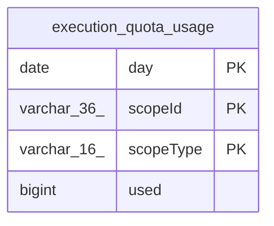

# execution_quota_usage

## Description

<details>
<summary><strong>Table Definition</strong></summary>

```sql
CREATE TABLE "execution_quota_usage" (
				"scopeType" varchar(16) NOT NULL CHECK ("scopeType" IN ('workflow', 'project')),
				"scopeId" varchar(36) NOT NULL,
				"day" date NOT NULL,
				"used" bigint NOT NULL,
				PRIMARY KEY ("scopeType", "scopeId", "day")
			)
```

</details>

## Columns

| Name | Type | Default | Nullable | Children | Parents | Comment |
| ---- | ---- | ------- | -------- | -------- | ------- | ------- |
| day | date |  | false |  |  |  |
| scopeId | varchar(36) |  | false |  |  |  |
| scopeType | varchar(16) |  | false |  |  |  |
| used | bigint |  | false |  |  |  |

## Constraints

| Name | Type | Definition |
| ---- | ---- | ---------- |
| - | CHECK | CHECK ("scopeType" IN ('workflow', 'project')) |
| day | PRIMARY KEY | PRIMARY KEY (day) |
| scopeId | PRIMARY KEY | PRIMARY KEY (scopeId) |
| scopeType | PRIMARY KEY | PRIMARY KEY (scopeType) |
| sqlite_autoindex_execution_quota_usage_1 | PRIMARY KEY | PRIMARY KEY (scopeType, scopeId, day) |

## Indexes

| Name | Definition |
| ---- | ---------- |
| sqlite_autoindex_execution_quota_usage_1 | PRIMARY KEY (scopeType, scopeId, day) |

## Relations



---

> Generated by [tbls](https://github.com/k1LoW/tbls)
