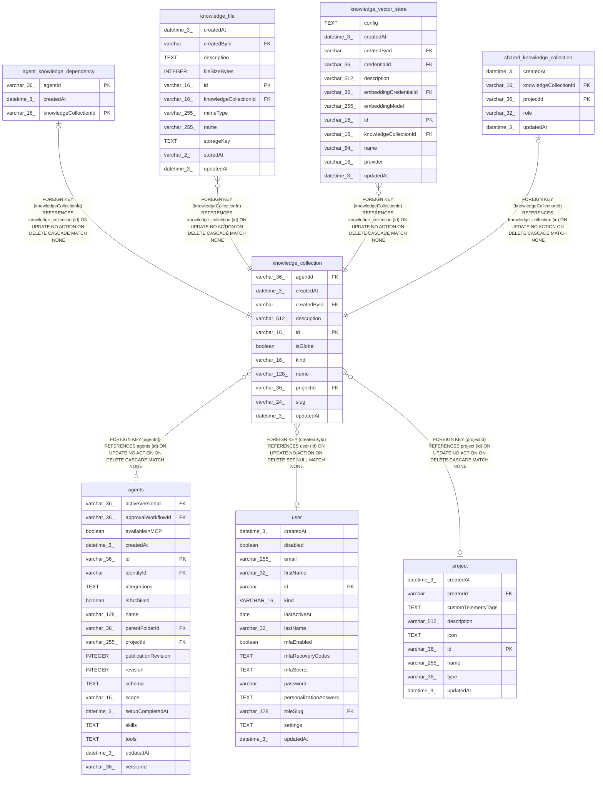

# knowledge_collection

## Description

<details>
<summary><strong>Table Definition</strong></summary>

```sql
CREATE TABLE "knowledge_collection" ("id" varchar(16) PRIMARY KEY NOT NULL, "name" varchar(128) NOT NULL, "description" varchar(512), "slug" varchar(24) NOT NULL, "kind" varchar(16) NOT NULL, "projectId" varchar(36), "agentId" varchar(36), "isGlobal" boolean NOT NULL DEFAULT (false), "createdById" varchar, "createdAt" datetime(3) NOT NULL DEFAULT (STRFTIME('%Y-%m-%d %H:%M:%f', 'NOW')), "updatedAt" datetime(3) NOT NULL DEFAULT (STRFTIME('%Y-%m-%d %H:%M:%f', 'NOW')), CONSTRAINT "CHK_knowledge_collection_owner" CHECK ((("agentId" IS NULL) <> ("projectId" IS NULL)) AND (("kind" = 'agent') = ("agentId" IS NOT NULL)) AND ("agentId" IS NULL OR "isGlobal" = 0)), CONSTRAINT "FK_d99632e9dc75614f710319df742" FOREIGN KEY ("projectId") REFERENCES "project" ("id") ON DELETE CASCADE, CONSTRAINT "FK_2db6cab650ebf156debd84c3772" FOREIGN KEY ("agentId") REFERENCES "agents" ("id") ON DELETE CASCADE, CONSTRAINT "FK_3dbb6554cfa9ce504a94274c64f" FOREIGN KEY ("createdById") REFERENCES "user" ("id") ON DELETE SET NULL)
```

</details>

## Columns

| Name | Type | Default | Nullable | Children | Parents | Comment |
| ---- | ---- | ------- | -------- | -------- | ------- | ------- |
| agentId | varchar(36) |  | true |  | [agents](agents.md) |  |
| createdAt | datetime(3) | STRFTIME('%Y-%m-%d %H:%M:%f', 'NOW') | false |  |  |  |
| createdById | varchar |  | true |  | [user](user.md) |  |
| description | varchar(512) |  | true |  |  |  |
| id | varchar(16) |  | false | [agent_knowledge_dependency](agent_knowledge_dependency.md) [knowledge_file](knowledge_file.md) [knowledge_vector_store](knowledge_vector_store.md) [shared_knowledge_collection](shared_knowledge_collection.md) |  |  |
| isGlobal | boolean | false | false |  |  |  |
| kind | varchar(16) |  | false |  |  |  |
| name | varchar(128) |  | false |  |  |  |
| projectId | varchar(36) |  | true |  | [project](project.md) |  |
| slug | varchar(24) |  | false |  |  |  |
| updatedAt | datetime(3) | STRFTIME('%Y-%m-%d %H:%M:%f', 'NOW') | false |  |  |  |

## Constraints

| Name | Type | Definition |
| ---- | ---- | ---------- |
| - | CHECK | CHECK ((("agentId" IS NULL) <> ("projectId" IS NULL)) AND (("kind" = 'agent') = ("agentId" IS NOT NULL)) AND ("agentId" IS NULL OR "isGlobal" = 0)) |
| - (Foreign key ID: 0) | FOREIGN KEY | FOREIGN KEY (createdById) REFERENCES user (id) ON UPDATE NO ACTION ON DELETE SET NULL MATCH NONE |
| - (Foreign key ID: 1) | FOREIGN KEY | FOREIGN KEY (agentId) REFERENCES agents (id) ON UPDATE NO ACTION ON DELETE CASCADE MATCH NONE |
| - (Foreign key ID: 2) | FOREIGN KEY | FOREIGN KEY (projectId) REFERENCES project (id) ON UPDATE NO ACTION ON DELETE CASCADE MATCH NONE |
| id | PRIMARY KEY | PRIMARY KEY (id) |
| sqlite_autoindex_knowledge_collection_1 | PRIMARY KEY | PRIMARY KEY (id) |

## Indexes

| Name | Definition |
| ---- | ---------- |
| IDX_2db6cab650ebf156debd84c377 | CREATE UNIQUE INDEX "IDX_2db6cab650ebf156debd84c377" ON "knowledge_collection" ("agentId")  |
| IDX_7668e1c858cbe75167f74145df | CREATE UNIQUE INDEX "IDX_7668e1c858cbe75167f74145df" ON "knowledge_collection" ("projectId", "name")  |
| IDX_f99bb4c895c3203736ce2da3f4 | CREATE UNIQUE INDEX "IDX_f99bb4c895c3203736ce2da3f4" ON "knowledge_collection" ("slug")  |
| sqlite_autoindex_knowledge_collection_1 | PRIMARY KEY (id) |

## Relations



---

> Generated by [tbls](https://github.com/k1LoW/tbls)
