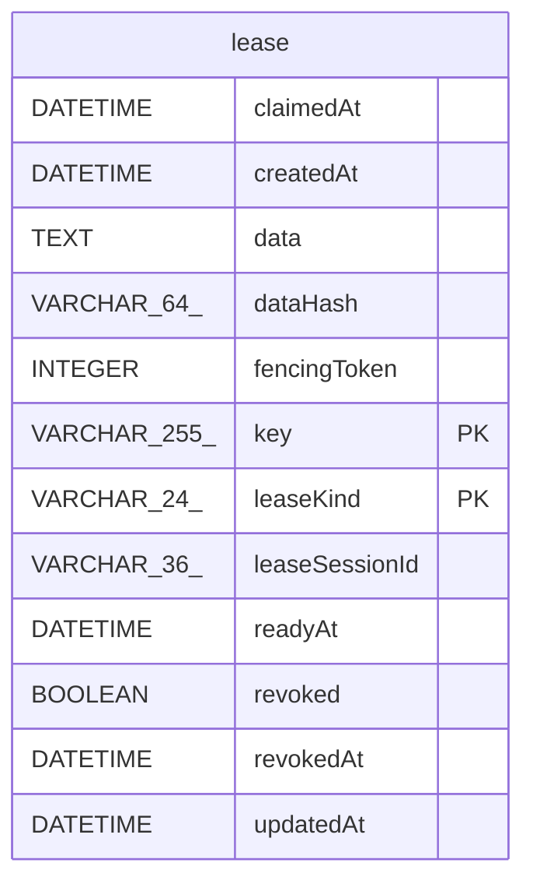

# lease

## Description

<details>
<summary><strong>Table Definition</strong></summary>

```sql
CREATE TABLE "lease" (
			"leaseKind" VARCHAR(24) NOT NULL,
			"key" VARCHAR(255) NOT NULL,
			"data" TEXT NOT NULL,
			"dataHash" VARCHAR(64) NOT NULL,
			"leaseSessionId" VARCHAR(36) NULL,
			"fencingToken" INTEGER NOT NULL DEFAULT 0 CONSTRAINT "CHK_lease_fencingToken" CHECK ("fencingToken" >= 0),
			"claimedAt" DATETIME NULL,
			"readyAt" DATETIME NULL,
			"revoked" BOOLEAN NOT NULL DEFAULT 0,
			"revokedAt" DATETIME NULL,
			"createdAt" DATETIME NOT NULL DEFAULT (STRFTIME('%Y-%m-%d %H:%M:%f','NOW')),
			"updatedAt" DATETIME NOT NULL DEFAULT (STRFTIME('%Y-%m-%d %H:%M:%f','NOW')),
			PRIMARY KEY ("leaseKind", "key")
		)
```

</details>

## Columns

| Name | Type | Default | Nullable | Children | Parents | Comment |
| ---- | ---- | ------- | -------- | -------- | ------- | ------- |
| claimedAt | DATETIME |  | true |  |  |  |
| createdAt | DATETIME | STRFTIME('%Y-%m-%d %H:%M:%f','NOW') | false |  |  |  |
| data | TEXT |  | false |  |  |  |
| dataHash | VARCHAR(64) |  | false |  |  |  |
| fencingToken | INTEGER | 0 | false |  |  |  |
| key | VARCHAR(255) |  | false |  |  |  |
| leaseKind | VARCHAR(24) |  | false |  |  |  |
| leaseSessionId | VARCHAR(36) |  | true |  |  |  |
| readyAt | DATETIME |  | true |  |  |  |
| revoked | BOOLEAN | 0 | false |  |  |  |
| revokedAt | DATETIME |  | true |  |  |  |
| updatedAt | DATETIME | STRFTIME('%Y-%m-%d %H:%M:%f','NOW') | false |  |  |  |

## Constraints

| Name | Type | Definition |
| ---- | ---- | ---------- |
| - | CHECK | CHECK ("fencingToken" >= 0) |
| key | PRIMARY KEY | PRIMARY KEY (key) |
| leaseKind | PRIMARY KEY | PRIMARY KEY (leaseKind) |
| sqlite_autoindex_lease_1 | PRIMARY KEY | PRIMARY KEY (leaseKind, key) |

## Indexes

| Name | Definition |
| ---- | ---------- |
| IDX_lease_leaseKind_leaseSessionId | CREATE INDEX "IDX_lease_leaseKind_leaseSessionId" ON "lease" ("leaseKind", "leaseSessionId") |
| sqlite_autoindex_lease_1 | PRIMARY KEY (leaseKind, key) |

## Relations



---

> Generated by [tbls](https://github.com/k1LoW/tbls)
