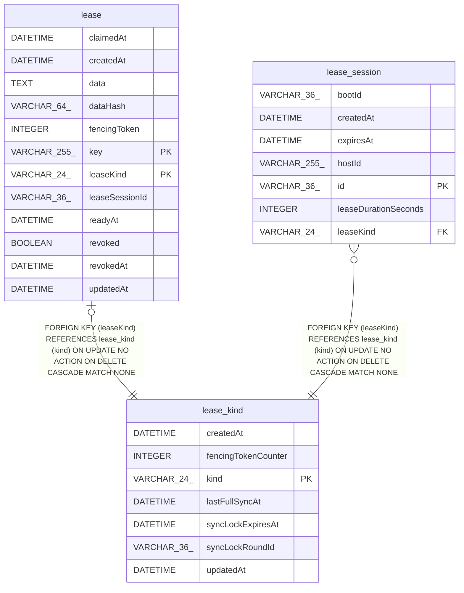

# lease_kind

## Description

<details>
<summary><strong>Table Definition</strong></summary>

```sql
CREATE TABLE "lease_kind" (
			"kind" VARCHAR(24) NOT NULL PRIMARY KEY,
			"fencingTokenCounter" INTEGER NOT NULL DEFAULT 0 CONSTRAINT "CHK_lease_kind_fencingTokenCounter" CHECK ("fencingTokenCounter" >= 0),
			"syncLockRoundId" VARCHAR(36) NULL,
			"syncLockExpiresAt" DATETIME NULL,
			"lastFullSyncAt" DATETIME NULL,
			"createdAt" DATETIME NOT NULL DEFAULT (STRFTIME('%Y-%m-%d %H:%M:%f','NOW')),
			"updatedAt" DATETIME NOT NULL DEFAULT (STRFTIME('%Y-%m-%d %H:%M:%f','NOW'))
		)
```

</details>

## Columns

| Name | Type | Default | Nullable | Children | Parents | Comment |
| ---- | ---- | ------- | -------- | -------- | ------- | ------- |
| createdAt | DATETIME | STRFTIME('%Y-%m-%d %H:%M:%f','NOW') | false |  |  |  |
| fencingTokenCounter | INTEGER | 0 | false |  |  |  |
| kind | VARCHAR(24) |  | false | [lease](lease.md) [lease_session](lease_session.md) |  |  |
| lastFullSyncAt | DATETIME |  | true |  |  |  |
| syncLockExpiresAt | DATETIME |  | true |  |  |  |
| syncLockRoundId | VARCHAR(36) |  | true |  |  |  |
| updatedAt | DATETIME | STRFTIME('%Y-%m-%d %H:%M:%f','NOW') | false |  |  |  |

## Constraints

| Name | Type | Definition |
| ---- | ---- | ---------- |
| - | CHECK | CHECK ("fencingTokenCounter" >= 0) |
| kind | PRIMARY KEY | PRIMARY KEY (kind) |
| sqlite_autoindex_lease_kind_1 | PRIMARY KEY | PRIMARY KEY (kind) |

## Indexes

| Name | Definition |
| ---- | ---------- |
| sqlite_autoindex_lease_kind_1 | PRIMARY KEY (kind) |

## Relations



---

> Generated by [tbls](https://github.com/k1LoW/tbls)
