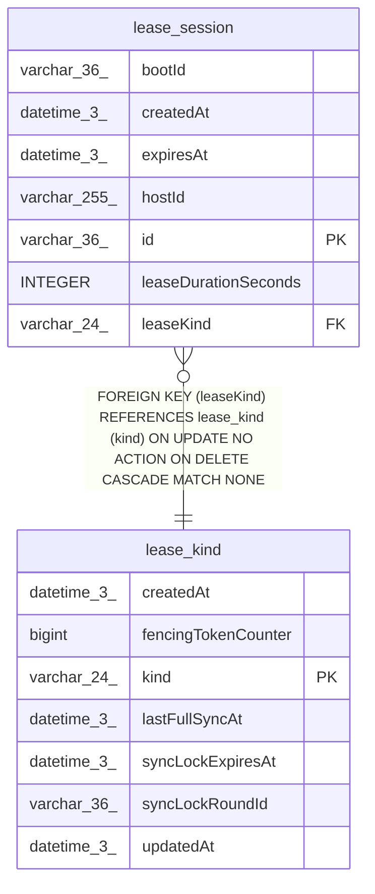

# lease_session

## Description

<details>
<summary><strong>Table Definition</strong></summary>

```sql
CREATE TABLE "lease_session" ("id" varchar(36) PRIMARY KEY NOT NULL, "leaseKind" varchar(24) NOT NULL, "hostId" varchar(255) NOT NULL, "bootId" varchar(36) NOT NULL, "leaseDurationSeconds" integer NOT NULL, "expiresAt" datetime(3) NOT NULL, "createdAt" datetime(3) NOT NULL DEFAULT (STRFTIME('%Y-%m-%d %H:%M:%f', 'NOW')), CONSTRAINT "FK_lease_session_leaseKind" FOREIGN KEY ("leaseKind") REFERENCES "lease_kind" ("kind") ON DELETE CASCADE)
```

</details>

## Columns

| Name | Type | Default | Nullable | Children | Parents | Comment |
| ---- | ---- | ------- | -------- | -------- | ------- | ------- |
| bootId | varchar(36) |  | false |  |  |  |
| createdAt | datetime(3) | STRFTIME('%Y-%m-%d %H:%M:%f', 'NOW') | false |  |  |  |
| expiresAt | datetime(3) |  | false |  |  |  |
| hostId | varchar(255) |  | false |  |  |  |
| id | varchar(36) |  | false |  |  |  |
| leaseDurationSeconds | INTEGER |  | false |  |  |  |
| leaseKind | varchar(24) |  | false |  | [lease_kind](lease_kind.md) |  |

## Constraints

| Name | Type | Definition |
| ---- | ---- | ---------- |
| - (Foreign key ID: 0) | FOREIGN KEY | FOREIGN KEY (leaseKind) REFERENCES lease_kind (kind) ON UPDATE NO ACTION ON DELETE CASCADE MATCH NONE |
| id | PRIMARY KEY | PRIMARY KEY (id) |
| sqlite_autoindex_lease_session_1 | PRIMARY KEY | PRIMARY KEY (id) |

## Indexes

| Name | Definition |
| ---- | ---------- |
| IDX_lease_session_leaseKind_expiresAt | CREATE INDEX "IDX_lease_session_leaseKind_expiresAt" ON "lease_session" ("leaseKind", "expiresAt")  |
| sqlite_autoindex_lease_session_1 | PRIMARY KEY (id) |

## Relations



---

> Generated by [tbls](https://github.com/k1LoW/tbls)
