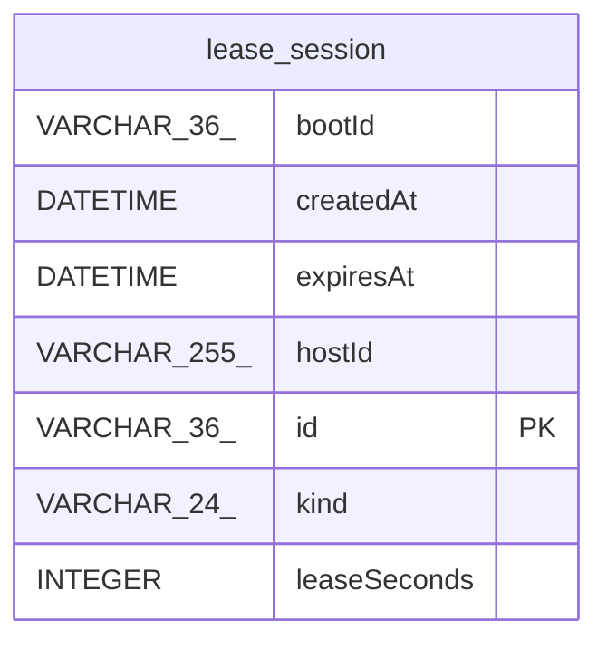

# lease_session

## Description

<details>
<summary><strong>Table Definition</strong></summary>

```sql
CREATE TABLE "lease_session" (
			"id" VARCHAR(36) NOT NULL PRIMARY KEY,
			"kind" VARCHAR(24) NOT NULL,
			"hostId" VARCHAR(255) NOT NULL,
			"bootId" VARCHAR(36) NOT NULL,
			"leaseSeconds" INTEGER NOT NULL,
			"expiresAt" DATETIME NOT NULL,
			"createdAt" DATETIME NOT NULL DEFAULT (STRFTIME('%Y-%m-%d %H:%M:%f','NOW'))
		)
```

</details>

## Columns

| Name | Type | Default | Nullable | Children | Parents | Comment |
| ---- | ---- | ------- | -------- | -------- | ------- | ------- |
| bootId | VARCHAR(36) |  | false |  |  |  |
| createdAt | DATETIME | STRFTIME('%Y-%m-%d %H:%M:%f','NOW') | false |  |  |  |
| expiresAt | DATETIME |  | false |  |  |  |
| hostId | VARCHAR(255) |  | false |  |  |  |
| id | VARCHAR(36) |  | false |  |  |  |
| kind | VARCHAR(24) |  | false |  |  |  |
| leaseSeconds | INTEGER |  | false |  |  |  |

## Constraints

| Name | Type | Definition |
| ---- | ---- | ---------- |
| id | PRIMARY KEY | PRIMARY KEY (id) |
| sqlite_autoindex_lease_session_1 | PRIMARY KEY | PRIMARY KEY (id) |

## Indexes

| Name | Definition |
| ---- | ---------- |
| IDX_lease_session_kind_expiresAt | CREATE INDEX "IDX_lease_session_kind_expiresAt" ON "lease_session" ("kind", "expiresAt") |
| sqlite_autoindex_lease_session_1 | PRIMARY KEY (id) |

## Relations



---

> Generated by [tbls](https://github.com/k1LoW/tbls)
