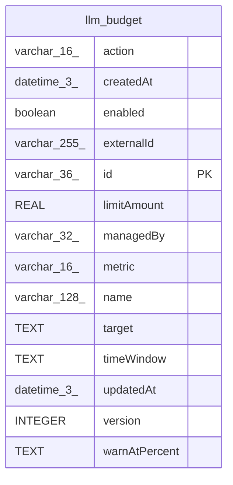

# llm_budget

## Description

<details>
<summary><strong>Table Definition</strong></summary>

```sql
CREATE TABLE "llm_budget" ("id" varchar(36) PRIMARY KEY NOT NULL, "name" varchar(128) NOT NULL, "enabled" boolean NOT NULL DEFAULT (true), "target" text NOT NULL, "timeWindow" text NOT NULL, "metric" varchar(16) NOT NULL, "limitAmount" real NOT NULL, "action" varchar(16) NOT NULL, "warnAtPercent" text NOT NULL, "managedBy" varchar(32), "externalId" varchar(255), "version" integer NOT NULL DEFAULT (1), "createdAt" datetime(3) NOT NULL DEFAULT (STRFTIME('%Y-%m-%d %H:%M:%f', 'NOW')), "updatedAt" datetime(3) NOT NULL DEFAULT (STRFTIME('%Y-%m-%d %H:%M:%f', 'NOW')), CONSTRAINT "CHK_llm_budget_metric" CHECK ("metric" IN ('costUsd')), CONSTRAINT "CHK_llm_budget_action" CHECK ("action" IN ('block', 'warn')))
```

</details>

## Columns

| Name | Type | Default | Nullable | Children | Parents | Comment |
| ---- | ---- | ------- | -------- | -------- | ------- | ------- |
| action | varchar(16) |  | false |  |  |  |
| createdAt | datetime(3) | STRFTIME('%Y-%m-%d %H:%M:%f', 'NOW') | false |  |  |  |
| enabled | boolean | true | false |  |  |  |
| externalId | varchar(255) |  | true |  |  |  |
| id | varchar(36) |  | false |  |  |  |
| limitAmount | REAL |  | false |  |  |  |
| managedBy | varchar(32) |  | true |  |  |  |
| metric | varchar(16) |  | false |  |  |  |
| name | varchar(128) |  | false |  |  |  |
| target | TEXT |  | false |  |  |  |
| timeWindow | TEXT |  | false |  |  |  |
| updatedAt | datetime(3) | STRFTIME('%Y-%m-%d %H:%M:%f', 'NOW') | false |  |  |  |
| version | INTEGER | 1 | false |  |  |  |
| warnAtPercent | TEXT |  | false |  |  |  |

## Constraints

| Name | Type | Definition |
| ---- | ---- | ---------- |
| - | CHECK | CHECK ("metric" IN ('costUsd')) |
| - | CHECK | CHECK ("action" IN ('block', 'warn')) |
| id | PRIMARY KEY | PRIMARY KEY (id) |
| sqlite_autoindex_llm_budget_1 | PRIMARY KEY | PRIMARY KEY (id) |

## Indexes

| Name | Definition |
| ---- | ---------- |
| sqlite_autoindex_llm_budget_1 | PRIMARY KEY (id) |

## Relations



---

> Generated by [tbls](https://github.com/k1LoW/tbls)
