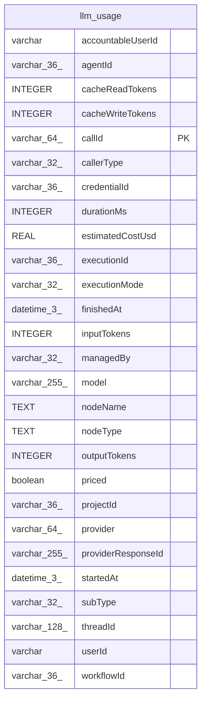

# llm_usage

## Description

<details>
<summary><strong>Table Definition</strong></summary>

```sql
CREATE TABLE "llm_usage" ("callId" varchar(64) PRIMARY KEY NOT NULL, "startedAt" datetime(3), "finishedAt" datetime(3) NOT NULL, "durationMs" integer, "callerType" varchar(32) NOT NULL, "subType" varchar(32), "workflowId" varchar(36), "executionId" varchar(36), "executionMode" varchar(32), "nodeName" text, "nodeType" text, "agentId" varchar(36), "threadId" varchar(128), "projectId" varchar(36), "userId" varchar, "credentialId" varchar(36), "managedBy" varchar(32), "provider" varchar(64) NOT NULL, "model" varchar(255) NOT NULL, "providerResponseId" varchar(255), "inputTokens" integer NOT NULL DEFAULT (0), "outputTokens" integer NOT NULL DEFAULT (0), "cacheReadTokens" integer NOT NULL DEFAULT (0), "cacheWriteTokens" integer NOT NULL DEFAULT (0), "estimatedCostUsd" real, "priced" boolean NOT NULL DEFAULT (false), "accountableUserId" varchar, CONSTRAINT "CHK_llm_usage_callerType" CHECK (("callerType" IN ('node', 'agent', 'instance-ai', 'workflow-builder', 'unknown'))), CONSTRAINT "CHK_llm_usage_subType" CHECK (("subType" IN ('llm', 'http'))), CONSTRAINT "CHK_llm_usage_managedBy" CHECK (("managedBy" IN ('aiGateway', 'assistant'))))
```

</details>

## Columns

| Name | Type | Default | Nullable | Children | Parents | Comment |
| ---- | ---- | ------- | -------- | -------- | ------- | ------- |
| accountableUserId | varchar |  | true |  |  |  |
| agentId | varchar(36) |  | true |  |  |  |
| cacheReadTokens | INTEGER | 0 | false |  |  |  |
| cacheWriteTokens | INTEGER | 0 | false |  |  |  |
| callId | varchar(64) |  | false |  |  |  |
| callerType | varchar(32) |  | false |  |  |  |
| credentialId | varchar(36) |  | true |  |  |  |
| durationMs | INTEGER |  | true |  |  |  |
| estimatedCostUsd | REAL |  | true |  |  |  |
| executionId | varchar(36) |  | true |  |  |  |
| executionMode | varchar(32) |  | true |  |  |  |
| finishedAt | datetime(3) |  | false |  |  |  |
| inputTokens | INTEGER | 0 | false |  |  |  |
| managedBy | varchar(32) |  | true |  |  |  |
| model | varchar(255) |  | false |  |  |  |
| nodeName | TEXT |  | true |  |  |  |
| nodeType | TEXT |  | true |  |  |  |
| outputTokens | INTEGER | 0 | false |  |  |  |
| priced | boolean | false | false |  |  |  |
| projectId | varchar(36) |  | true |  |  |  |
| provider | varchar(64) |  | false |  |  |  |
| providerResponseId | varchar(255) |  | true |  |  |  |
| startedAt | datetime(3) |  | true |  |  |  |
| subType | varchar(32) |  | true |  |  |  |
| threadId | varchar(128) |  | true |  |  |  |
| userId | varchar |  | true |  |  |  |
| workflowId | varchar(36) |  | true |  |  |  |

## Constraints

| Name | Type | Definition |
| ---- | ---- | ---------- |
| - | CHECK | CHECK (("callerType" IN ('node', 'agent', 'instance-ai', 'workflow-builder', 'unknown'))) |
| - | CHECK | CHECK (("subType" IN ('llm', 'http'))) |
| - | CHECK | CHECK (("managedBy" IN ('aiGateway', 'assistant'))) |
| callId | PRIMARY KEY | PRIMARY KEY (callId) |
| sqlite_autoindex_llm_usage_1 | PRIMARY KEY | PRIMARY KEY (callId) |

## Indexes

| Name | Definition |
| ---- | ---------- |
| IDX_04b3411fd7d9955fca7d25e5df | CREATE INDEX "IDX_04b3411fd7d9955fca7d25e5df" ON "llm_usage" ("finishedAt")  |
| IDX_llm_usage_callId | CREATE INDEX "IDX_llm_usage_callId" ON "llm_usage" ("callId") WHERE "priced" = false |
| sqlite_autoindex_llm_usage_1 | PRIMARY KEY (callId) |

## Relations



---

> Generated by [tbls](https://github.com/k1LoW/tbls)
