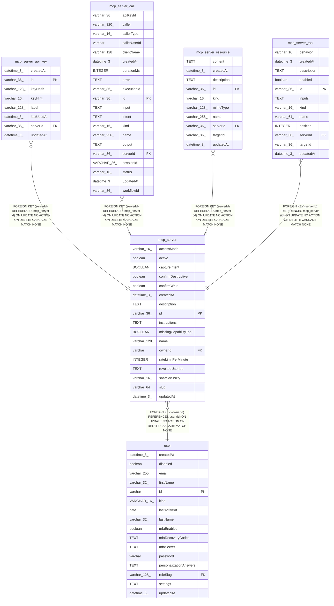

# mcp_server

## Description

<details>
<summary><strong>Table Definition</strong></summary>

```sql
CREATE TABLE "mcp_server" ("id" varchar(36) PRIMARY KEY NOT NULL, "slug" varchar(64) NOT NULL, "name" varchar(128) NOT NULL, "description" text NOT NULL, "instructions" text NOT NULL, "active" boolean NOT NULL DEFAULT (true), "accessMode" varchar(16) NOT NULL DEFAULT ('apiKey'), "rateLimitPerMinute" integer NOT NULL DEFAULT (60), "shareVisibility" varchar(16) NOT NULL DEFAULT ('instance'), "confirmDestructive" boolean NOT NULL DEFAULT (true), "confirmWrite" boolean NOT NULL DEFAULT (false), "revokedUserIds" text, "ownerId" varchar NOT NULL, "createdAt" datetime(3) NOT NULL DEFAULT (STRFTIME('%Y-%m-%d %H:%M:%f', 'NOW')), "updatedAt" datetime(3) NOT NULL DEFAULT (STRFTIME('%Y-%m-%d %H:%M:%f', 'NOW')), "captureIntent" BOOLEAN NOT NULL DEFAULT TRUE, "missingCapabilityTool" BOOLEAN NOT NULL DEFAULT TRUE, CONSTRAINT "FK_mcp_server_ownerId" FOREIGN KEY ("ownerId") REFERENCES "user" ("id") ON DELETE CASCADE)
```

</details>

## Columns

| Name | Type | Default | Nullable | Children | Parents | Comment |
| ---- | ---- | ------- | -------- | -------- | ------- | ------- |
| accessMode | varchar(16) | 'apiKey' | false |  |  |  |
| active | boolean | true | false |  |  |  |
| captureIntent | BOOLEAN | TRUE | false |  |  |  |
| confirmDestructive | boolean | true | false |  |  |  |
| confirmWrite | boolean | false | false |  |  |  |
| createdAt | datetime(3) | STRFTIME('%Y-%m-%d %H:%M:%f', 'NOW') | false |  |  |  |
| description | TEXT |  | false |  |  |  |
| id | varchar(36) |  | false | [mcp_server_api_key](mcp_server_api_key.md) [mcp_server_call](mcp_server_call.md) [mcp_server_resource](mcp_server_resource.md) [mcp_server_tool](mcp_server_tool.md) |  |  |
| instructions | TEXT |  | false |  |  |  |
| missingCapabilityTool | BOOLEAN | TRUE | false |  |  |  |
| name | varchar(128) |  | false |  |  |  |
| ownerId | varchar |  | false |  | [user](user.md) |  |
| rateLimitPerMinute | INTEGER | 60 | false |  |  |  |
| revokedUserIds | TEXT |  | true |  |  |  |
| shareVisibility | varchar(16) | 'instance' | false |  |  |  |
| slug | varchar(64) |  | false |  |  |  |
| updatedAt | datetime(3) | STRFTIME('%Y-%m-%d %H:%M:%f', 'NOW') | false |  |  |  |

## Constraints

| Name | Type | Definition |
| ---- | ---- | ---------- |
| - (Foreign key ID: 0) | FOREIGN KEY | FOREIGN KEY (ownerId) REFERENCES user (id) ON UPDATE NO ACTION ON DELETE CASCADE MATCH NONE |
| id | PRIMARY KEY | PRIMARY KEY (id) |
| sqlite_autoindex_mcp_server_1 | PRIMARY KEY | PRIMARY KEY (id) |

## Indexes

| Name | Definition |
| ---- | ---------- |
| IDX_c70bcc8686212f76f1d03a9bba | CREATE UNIQUE INDEX "IDX_c70bcc8686212f76f1d03a9bba" ON "mcp_server" ("slug")  |
| sqlite_autoindex_mcp_server_1 | PRIMARY KEY (id) |

## Relations



---

> Generated by [tbls](https://github.com/k1LoW/tbls)
