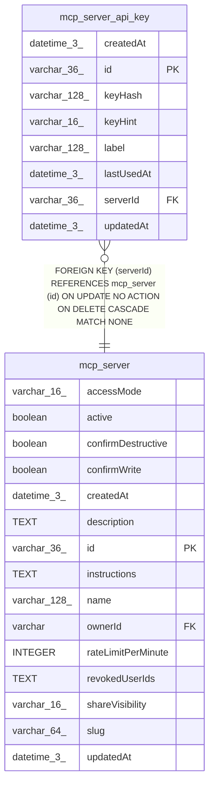

# mcp_server_api_key

## Description

<details>
<summary><strong>Table Definition</strong></summary>

```sql
CREATE TABLE "mcp_server_api_key" ("id" varchar(36) PRIMARY KEY NOT NULL, "serverId" varchar(36) NOT NULL, "label" varchar(128) NOT NULL, "keyHash" varchar(128) NOT NULL, "keyHint" varchar(16) NOT NULL, "lastUsedAt" datetime(3), "createdAt" datetime(3) NOT NULL DEFAULT (STRFTIME('%Y-%m-%d %H:%M:%f', 'NOW')), "updatedAt" datetime(3) NOT NULL DEFAULT (STRFTIME('%Y-%m-%d %H:%M:%f', 'NOW')), CONSTRAINT "FK_mcp_server_api_key_serverId" FOREIGN KEY ("serverId") REFERENCES "mcp_server" ("id") ON DELETE CASCADE)
```

</details>

## Columns

| Name | Type | Default | Nullable | Children | Parents | Comment |
| ---- | ---- | ------- | -------- | -------- | ------- | ------- |
| createdAt | datetime(3) | STRFTIME('%Y-%m-%d %H:%M:%f', 'NOW') | false |  |  |  |
| id | varchar(36) |  | false |  |  |  |
| keyHash | varchar(128) |  | false |  |  |  |
| keyHint | varchar(16) |  | false |  |  |  |
| label | varchar(128) |  | false |  |  |  |
| lastUsedAt | datetime(3) |  | true |  |  |  |
| serverId | varchar(36) |  | false |  | [mcp_server](mcp_server.md) |  |
| updatedAt | datetime(3) | STRFTIME('%Y-%m-%d %H:%M:%f', 'NOW') | false |  |  |  |

## Constraints

| Name | Type | Definition |
| ---- | ---- | ---------- |
| - (Foreign key ID: 0) | FOREIGN KEY | FOREIGN KEY (serverId) REFERENCES mcp_server (id) ON UPDATE NO ACTION ON DELETE CASCADE MATCH NONE |
| id | PRIMARY KEY | PRIMARY KEY (id) |
| sqlite_autoindex_mcp_server_api_key_1 | PRIMARY KEY | PRIMARY KEY (id) |

## Indexes

| Name | Definition |
| ---- | ---------- |
| IDX_7b9cf9633cd177e57ba22c740c | CREATE INDEX "IDX_7b9cf9633cd177e57ba22c740c" ON "mcp_server_api_key" ("serverId")  |
| IDX_ddb59676b54a3976eb508a3231 | CREATE UNIQUE INDEX "IDX_ddb59676b54a3976eb508a3231" ON "mcp_server_api_key" ("keyHash")  |
| sqlite_autoindex_mcp_server_api_key_1 | PRIMARY KEY (id) |

## Relations



---

> Generated by [tbls](https://github.com/k1LoW/tbls)
