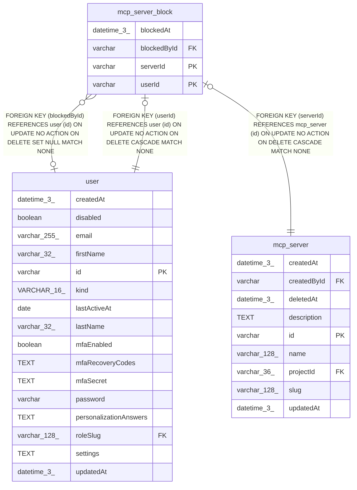

# mcp_server_block

## Description

<details>
<summary><strong>Table Definition</strong></summary>

```sql
CREATE TABLE "mcp_server_block" ("serverId" varchar NOT NULL, "userId" varchar NOT NULL, "blockedById" varchar, "blockedAt" datetime(3) NOT NULL DEFAULT (STRFTIME('%Y-%m-%d %H:%M:%f', 'NOW')), CONSTRAINT "FK_3d365ab7009dc331429a1a55049" FOREIGN KEY ("serverId") REFERENCES "mcp_server" ("id") ON DELETE CASCADE, CONSTRAINT "FK_319813a1818266a1f46efbd5c70" FOREIGN KEY ("userId") REFERENCES "user" ("id") ON DELETE CASCADE, CONSTRAINT "FK_707fcb57b18801980b8774f31f6" FOREIGN KEY ("blockedById") REFERENCES "user" ("id") ON DELETE SET NULL, PRIMARY KEY ("serverId", "userId"))
```

</details>

## Columns

| Name | Type | Default | Nullable | Children | Parents | Comment |
| ---- | ---- | ------- | -------- | -------- | ------- | ------- |
| blockedAt | datetime(3) | STRFTIME('%Y-%m-%d %H:%M:%f', 'NOW') | false |  |  |  |
| blockedById | varchar |  | true |  | [user](user.md) |  |
| serverId | varchar |  | false |  | [mcp_server](mcp_server.md) |  |
| userId | varchar |  | false |  | [user](user.md) |  |

## Constraints

| Name | Type | Definition |
| ---- | ---- | ---------- |
| - (Foreign key ID: 0) | FOREIGN KEY | FOREIGN KEY (blockedById) REFERENCES user (id) ON UPDATE NO ACTION ON DELETE SET NULL MATCH NONE |
| - (Foreign key ID: 1) | FOREIGN KEY | FOREIGN KEY (userId) REFERENCES user (id) ON UPDATE NO ACTION ON DELETE CASCADE MATCH NONE |
| - (Foreign key ID: 2) | FOREIGN KEY | FOREIGN KEY (serverId) REFERENCES mcp_server (id) ON UPDATE NO ACTION ON DELETE CASCADE MATCH NONE |
| serverId | PRIMARY KEY | PRIMARY KEY (serverId) |
| sqlite_autoindex_mcp_server_block_1 | PRIMARY KEY | PRIMARY KEY (serverId, userId) |
| userId | PRIMARY KEY | PRIMARY KEY (userId) |

## Indexes

| Name | Definition |
| ---- | ---------- |
| IDX_319813a1818266a1f46efbd5c7 | CREATE INDEX "IDX_319813a1818266a1f46efbd5c7" ON "mcp_server_block" ("userId")  |
| IDX_707fcb57b18801980b8774f31f | CREATE INDEX "IDX_707fcb57b18801980b8774f31f" ON "mcp_server_block" ("blockedById")  |
| sqlite_autoindex_mcp_server_block_1 | PRIMARY KEY (serverId, userId) |

## Relations



---

> Generated by [tbls](https://github.com/k1LoW/tbls)
