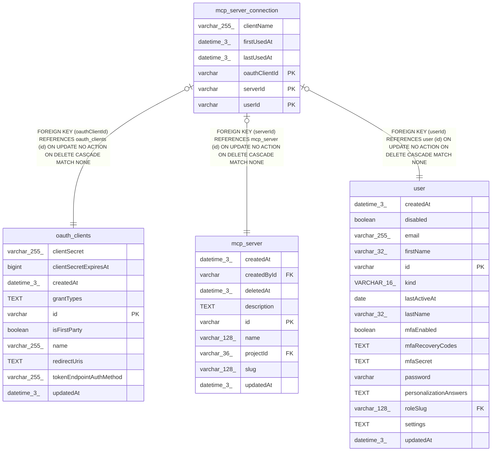

# mcp_server_connection

## Description

<details>
<summary><strong>Table Definition</strong></summary>

```sql
CREATE TABLE "mcp_server_connection" ("serverId" varchar NOT NULL, "userId" varchar NOT NULL, "oauthClientId" varchar NOT NULL, "clientName" varchar(255) NOT NULL, "firstUsedAt" datetime(3) NOT NULL DEFAULT (STRFTIME('%Y-%m-%d %H:%M:%f', 'NOW')), "lastUsedAt" datetime(3) NOT NULL DEFAULT (STRFTIME('%Y-%m-%d %H:%M:%f', 'NOW')), CONSTRAINT "FK_44cbc3141b2934c93bf2e5192b7" FOREIGN KEY ("serverId") REFERENCES "mcp_server" ("id") ON DELETE CASCADE, CONSTRAINT "FK_d0ffd17b8b5e4ad17f21d8414b0" FOREIGN KEY ("userId") REFERENCES "user" ("id") ON DELETE CASCADE, CONSTRAINT "FK_285ef9ea4a8408da7a473bd8add" FOREIGN KEY ("oauthClientId") REFERENCES "oauth_clients" ("id") ON DELETE CASCADE, PRIMARY KEY ("serverId", "userId", "oauthClientId"))
```

</details>

## Columns

| Name | Type | Default | Nullable | Children | Parents | Comment |
| ---- | ---- | ------- | -------- | -------- | ------- | ------- |
| clientName | varchar(255) |  | false |  |  |  |
| firstUsedAt | datetime(3) | STRFTIME('%Y-%m-%d %H:%M:%f', 'NOW') | false |  |  |  |
| lastUsedAt | datetime(3) | STRFTIME('%Y-%m-%d %H:%M:%f', 'NOW') | false |  |  |  |
| oauthClientId | varchar |  | false |  | [oauth_clients](oauth_clients.md) |  |
| serverId | varchar |  | false |  | [mcp_server](mcp_server.md) |  |
| userId | varchar |  | false |  | [user](user.md) |  |

## Constraints

| Name | Type | Definition |
| ---- | ---- | ---------- |
| - (Foreign key ID: 0) | FOREIGN KEY | FOREIGN KEY (oauthClientId) REFERENCES oauth_clients (id) ON UPDATE NO ACTION ON DELETE CASCADE MATCH NONE |
| - (Foreign key ID: 1) | FOREIGN KEY | FOREIGN KEY (userId) REFERENCES user (id) ON UPDATE NO ACTION ON DELETE CASCADE MATCH NONE |
| - (Foreign key ID: 2) | FOREIGN KEY | FOREIGN KEY (serverId) REFERENCES mcp_server (id) ON UPDATE NO ACTION ON DELETE CASCADE MATCH NONE |
| oauthClientId | PRIMARY KEY | PRIMARY KEY (oauthClientId) |
| serverId | PRIMARY KEY | PRIMARY KEY (serverId) |
| sqlite_autoindex_mcp_server_connection_1 | PRIMARY KEY | PRIMARY KEY (serverId, userId, oauthClientId) |
| userId | PRIMARY KEY | PRIMARY KEY (userId) |

## Indexes

| Name | Definition |
| ---- | ---------- |
| IDX_285ef9ea4a8408da7a473bd8ad | CREATE INDEX "IDX_285ef9ea4a8408da7a473bd8ad" ON "mcp_server_connection" ("oauthClientId")  |
| IDX_d0ffd17b8b5e4ad17f21d8414b | CREATE INDEX "IDX_d0ffd17b8b5e4ad17f21d8414b" ON "mcp_server_connection" ("userId")  |
| sqlite_autoindex_mcp_server_connection_1 | PRIMARY KEY (serverId, userId, oauthClientId) |

## Relations



---

> Generated by [tbls](https://github.com/k1LoW/tbls)
