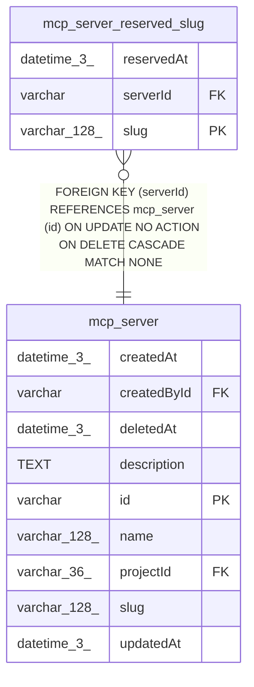

# mcp_server_reserved_slug

## Description

<details>
<summary><strong>Table Definition</strong></summary>

```sql
CREATE TABLE "mcp_server_reserved_slug" ("slug" varchar(128) PRIMARY KEY NOT NULL, "serverId" varchar NOT NULL, "reservedAt" datetime(3) NOT NULL DEFAULT (STRFTIME('%Y-%m-%d %H:%M:%f', 'NOW')), CONSTRAINT "FK_48f49acd341981bf2beb0ba813a" FOREIGN KEY ("serverId") REFERENCES "mcp_server" ("id") ON DELETE CASCADE)
```

</details>

## Columns

| Name | Type | Default | Nullable | Children | Parents | Comment |
| ---- | ---- | ------- | -------- | -------- | ------- | ------- |
| reservedAt | datetime(3) | STRFTIME('%Y-%m-%d %H:%M:%f', 'NOW') | false |  |  |  |
| serverId | varchar |  | false |  | [mcp_server](mcp_server.md) |  |
| slug | varchar(128) |  | false |  |  |  |

## Constraints

| Name | Type | Definition |
| ---- | ---- | ---------- |
| - (Foreign key ID: 0) | FOREIGN KEY | FOREIGN KEY (serverId) REFERENCES mcp_server (id) ON UPDATE NO ACTION ON DELETE CASCADE MATCH NONE |
| slug | PRIMARY KEY | PRIMARY KEY (slug) |
| sqlite_autoindex_mcp_server_reserved_slug_1 | PRIMARY KEY | PRIMARY KEY (slug) |

## Indexes

| Name | Definition |
| ---- | ---------- |
| IDX_48f49acd341981bf2beb0ba813 | CREATE INDEX "IDX_48f49acd341981bf2beb0ba813" ON "mcp_server_reserved_slug" ("serverId")  |
| sqlite_autoindex_mcp_server_reserved_slug_1 | PRIMARY KEY (slug) |

## Relations



---

> Generated by [tbls](https://github.com/k1LoW/tbls)
